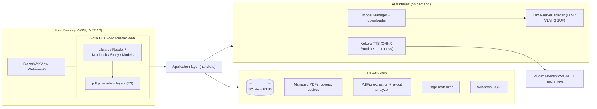
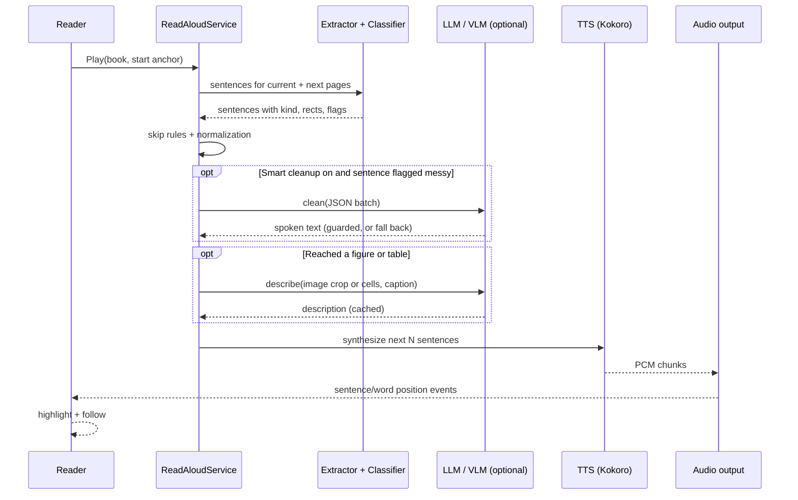
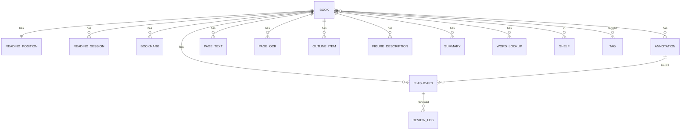

# Folio — Desktop PDF Library & Reader

> **Superseded in part by Folio 3D** ([docs/folio-3d/SPEC.md](folio-3d/SPEC.md)): the library is now a 3D stage with a 2D fallback, Folio also ships as a web app, and marginalia, the Notebook, OCR and quote-with-citation were removed. Where the two documents differ, the Folio 3D specification and its [decisions log](folio-3d/DECISIONS.md) apply.

### Product & Technical Specification · v0.1 (draft) · 2026-10-08

> **Working title:** "Folio" (placeholder, rename freely).
> **Audience:** the author, and an AI coding agent that will implement from this document.
> **Status:** Draft for review. Items tagged **[ASSUMPTION]** need your confirmation. Items tagged **[VERIFY]** are version- or vendor-sensitive facts to re-check when the work starts.

## How to read this spec

- Requirement IDs: `FR-<area>-<nn>` (functional), `NFR-<nn>` (non-functional).
- Priorities: **M** = must-have for v1, **S** = should (v1 if time allows), **C** = could (post-v1), **W** = won't (explicitly out).
- Every M and S requirement has an acceptance criterion (AC) or is directly testable.
- Build in the milestone order of §10. Start with the spikes (M0): they decide the riskiest choices before anything else is built.
- Where this spec is silent, pick the simplest option that keeps data **local, non-destructive and reversible**, and record the choice in `/docs/decisions.md`.

---

## 1. Product overview

### 1.1 Vision

A calm, local-only Windows app that turns your PDFs into a personal bookshelf. It should feel like a well-loved paperback. It always opens where you left off, you can dog-ear pages and write in the margins, and the page sits under warm lamplight. It should also do what paper can't: instant search, adjustable text, a natural voice that reads to you (and describes figures when it reaches them), and a recap when you come back after a break. Everything runs on your machine.

### 1.2 Goals

| # | Goal |
|---|---|
| G1 | Manage PDFs as books: library, shelves, progress. |
| G2 | Read comfortably for hours: themes, lighting, typography, focus aids. |
| G3 | Never lose your place or your thoughts: position memory, bookmarks, highlights, margin notes, Notebook. |
| G4 | Listen: local neural read-aloud with smart text cleanup and on-demand figure/table descriptions. |
| G5 | Study: chapter summaries and recaps, define/explain, flashcards from highlights. |
| G6 | 100% local: no accounts, no telemetry, no cloud. The network is used only for model downloads you start. |
| G7 | A Material Design 3 look and feel with a "paper and lamplight" character. |

### 1.3 Non-goals (v1)

Editing or writing annotations into the PDF file · form filling and signing · DRM · EPUB/MOBI (the design leaves room) · cloud sync and mobile apps · multi-user · online dictionaries and web search · cloud AI · non-English TTS/OCR · Windows 10 · macOS/Linux.

### 1.4 User and context

One power user on a Windows 11 x64 laptop, long reading sessions, mixed PDFs (textbooks, technical books, papers, some scans).

**Reference machine [ASSUMPTION A2]:** Windows 11, Intel Core i7-1370P (13th gen), 64 GB RAM, CPU-only inference (the laptop's small discrete GPU is not relied on). All performance budgets in §5 are calibrated to this machine.

### 1.5 Design principles

1. **Paper first.** The page is the hero. Chrome hides itself; nothing blinks, badges or nags.
2. **Never lose anything.** Position, marks and notes are saved continuously and survive crashes.
3. **Non-destructive.** PDFs are never modified. Annotations live in the app database.
4. **Local and quiet.** No background network. AI runs only when asked, and stops when idle.
5. **Honest AI.** AI output is labelled, editable and never overwrites the reader's own words.
6. **Fast.** Open instantly, scroll smoothly, search instantly.

### 1.6 Success criteria

| Criterion | Target |
|---|---|
| Resume | Reopening any book lands on the last-read spot (within 1 page, ≤ 3 s of reading lost even after a forced kill). |
| Reading feel | Hour-long session with no visible jank (≥ 55 fps average scrolling; input latency ≤ 100 ms). |
| Read-aloud | First audio ≤ 3 s after pressing Play (warm model); sustained speed ≥ 2× real time with the default voice. |
| Cleanup quality | Running headers/footers/page numbers removed from narration in ≥ 95% of sampled pages of the test corpus. |
| Annotation safety | PDF files byte-identical (SHA-256) after any amount of use; ≥ 99% of highlights re-anchor after re-extraction. |
| Privacy | Zero outbound connections except user-started model downloads (verified by a network-block test). |

---

## 2. Discovery decisions and assumptions

### 2.1 Decisions you made

| # | Topic | Decision | Consequence in this spec |
|---|---|---|---|
| D1 | Platform | Windows only | Use Windows-native pieces (WebView2, WinRT OCR, media transport controls). No cross-platform abstraction cost. |
| D2 | Stack | You asked for a recommendation | §7.1 recommends and justifies a stack. |
| D3 | Audience | Personal use | Licensing and support concerns are light. Still avoid AGPL/GPL where it's cheap. |
| D4 | Read-aloud AI | Voice + text cleanup + figure/table descriptions | Needs a TTS model, an LLM and a vision model (§8.1, §8.2). |
| D5 | Annotation storage | Separate database, PDFs untouched | Anchoring strategy §8.5. Export-with-annotations is optional (C). |
| D6 | Reflow | Exact pages plus an optional reflow mode | Reflow engine §8.4. Anchors resolve in both modes. |
| D7 | Physical-book touches | Dog-ear bookmarks + margin notes; warm paper themes + lighting | Both are M. Page-turn animation/sound and two-page spread are C. |
| D8 | PDF types | Mix, some scanned | OCR pipeline §8.3. |
| D9 | Language | English only | English TTS voices and English OCR. |
| D10 | Model runtime | Bundled in the app, runs only when needed, download/select models from the UI | Sidecar runtime + Model Manager + lazy start/idle stop (§8.2). |
| D11 | Figure/table descriptions | On demand, as reading reaches them | Small look-ahead window and a cache (§8.1.5). |
| D12 | Extra AI | Chapter summaries & recaps, explain/define, flashcards from highlights | Epic AIS. Chat-with-book is not in v1. |

### 2.2 Assumptions I made (please confirm or correct)

| # | Assumption |
|---|---|
| A1 | Working name "Folio" is a placeholder. |
| A2 | Reference hardware is the CPU-only Windows 11 laptop described in §1.4. |
| A3 | Single local user. No accounts, no cloud sync. Protection is local backup/restore plus export. |
| A4 | Library size up to about 5,000 PDFs. Imported files are **copied** into a managed library (SHA-256 de-duplication). Originals are never touched. |
| A5 | PDF only in v1. The document layer sits behind an interface so EPUB can be added later. |
| A6 | UI, TTS and OCR are English only. |
| A7 | Margin notes are typed text (Markdown-lite). Pen/ink is not in v1. |
| A8 | Windows 11 x64 only. The WebView2 runtime is installed by the installer if missing. |
| A9 | Default voice is a Kokoro English voice (§8.1). |
| A10 | No telemetry and no auto-update. Updates are manual. |
| A11 | Reflow is built heuristically from the PDF's text and layout. It is not Adobe-Liquid-Mode-grade for every document. Quality varies by PDF and a "view original" escape is always one key away. |
| A12 | AI runs only on user action (or an explicitly enabled "auto-offer"). There is no background LLM indexing. Non-LLM indexing (text extraction, search index, OCR) may run in the background and is throttled. |
| A13 | Page-turn animation and two-page spread are not in v1 (you didn't pick them). They remain C. |
| A14 | OCR for scanned pages starts when you open the book (current page first, then outward) rather than at import, so import stays fast. |

---

## 3. Research: existing solutions and what we adopt

Sources are listed in Appendix D. Features below come from each product's own documentation or release notes unless marked otherwise.

### 3.1 Landscape summary

| Product | What it does best | What Folio takes from it |
|---|---|---|
| **SumatraPDF** (Windows) | Tiny, instant, keyboard-friendly. A command palette arrived in 3.4 and was improved in 3.6, alongside annotation editing and customizable shortcuts. Its dark theme uses colour inversion, which its own notes say works poorly with images. | Speed bar; command palette; customizable shortcuts; image-safe recolouring (§6.4). |
| **Sioyek** | Built for textbooks and papers. Smart Jump (preview references even without links), named *marks* for quick jump-back, text-labelled bookmarks, portals (linked second view), coloured highlights, searchable TOC (generated when missing), searchable command palette, keyboard-first. | Jump-back markers; generated outline; bookmark and highlight search; command palette; split view. |
| **Calibre viewer (8.x)** | Local-only neural read aloud (Piper engine), saved viewer profiles, work on page headers/footers being interleaved with body text when importing PDFs, and library full-text search. | Local neural TTS; header/footer detection; saved reading profiles; library-wide full-text search. |
| **Zotero reader** | Highlights, underlines, sticky notes, image-area annotations, colour filters, annotation sidebar. Annotations are stored **in the database, not in the file**, with export of a PDF that embeds them, plus import of annotations made elsewhere. Annotations drag into notes with back-links. Split reader. | Same storage model; Notebook; annotation import; deep links back to the page. |
| **KOReader** | Reflow of complex PDFs; OCR-then-reflow for scans; multi-page highlight ("two-tap"); bookmark/highlight browser with search; highlight export (text/Markdown/Readwise/Joplin); reading statistics (progress, time, calendar views); dictionary lookup, including in scanned PDFs; Book Map and page browser. | Multi-page highlights; export formats; reading stats; reflow and OCR strategy. |
| **Readest** (open source) | Library management, reading ruler, paragraph-by-paragraph mode, speed reading, file association. Built with Tauri and pdf.js on WebView2 on Windows. | Focus aids; proof that a pdf.js + WebView2 reader works well on Windows. |
| **Adobe Acrobat** | Reflow view; Read Out Loud; "replace document colours" for readability; Liquid Mode reflow with AI-generated outline (non-destructive, 200-page cap on mobile). | Reflow as a non-destructive view; theme recolouring of documents. |
| **Microsoft Edge (PDF + Immersive Reader)** | Read Aloud for PDFs; text spacing/size/font/theme controls; line focus (1/3/5 lines); picture dictionary; grammar tools. | Line focus; typography controls; Read Aloud UX. |
| **Speechify / Voice Dream-style readers** | "Skip content" controls: headers, footers, citations, brackets, URLs, footnotes; auto-increasing speed; auto-scroll with reading; scan-to-read. | Smart-skip categories; auto-follow scrolling; speed ramp (C). |
| **Kindle** (product knowledge) | Notebook of all highlights, Vocabulary Builder (looked-up words become flashcards), X-Ray, Whispersync, reading insights, reading-progress indicators ("time left in chapter"). | Notebook; vocabulary list and flashcards; time-left indicators. |

### 3.2 Feature adoption table

| Feature (seen in) | Folio priority |
|---|---|
| Resume at last position (all) | **M** |
| Highlights in colours + annotation sidebar with colour filter (Zotero, Sioyek) | **M** |
| Notes in the margin / sticky notes (Zotero, KOReader) | **M** |
| Annotations stored outside the file (Zotero) | **M** |
| Export notes/highlights as Markdown/JSON/CSV (KOReader, Kindle Notebook) | **M** |
| Dog-ear bookmark + named bookmarks (Sioyek bookmarks; physical books) | **M** |
| Document recolouring for dark/sepia reading (Acrobat) | **M** |
| Local neural read-aloud (Calibre) with a follow-along reading cursor (Speechify, Voice Dream) | **M** |
| Skip headers/footers/citations/URLs in narration (Speechify, Calibre) | **M** |
| Command palette + customizable shortcuts (Sumatra, Sioyek) | **M** |
| Reflow reading mode (Acrobat, KOReader) | **S** |
| OCR text layer for scanned PDFs (KOReader) | **S** |
| Library-wide full-text search (Calibre; planned in Readest) | **S** |
| Reading statistics and time-left estimates (KOReader, Kindle) | **S** |
| Line focus / reading ruler (Edge, Readest) | **S** |
| Jump-back markers (Sioyek marks) | **S** |
| Generated outline when missing (Sioyek, Acrobat Liquid Mode) | **S** |
| Import annotations from the PDF file (Zotero) | **S** |
| Split view of the same book (Zotero, Sioyek portals) | **S** |
| Multi-page highlight (KOReader) | **S** |
| Saved viewer profiles (Calibre) | **S** (as theme presets) |
| Vocabulary list from lookups (Kindle) | **S** |
| Smart reference preview / Smart Jump (Sioyek) | **C** |
| Export a PDF with annotations embedded (Zotero) | **C** |
| Two-page spread, page-turn animation (Sumatra ebook 2-page view; physical-book feel) | **C** |
| Auto speed ramp (Speechify) | **C** |
| Whispersync-style cross-device sync, web translation, picture dictionary | **W** |

### 3.3 Where Folio can beat a physical book

- **Never lose your place**, and a one-click "Continue reading".
- **Marginalia without limits**: a margin lane that grows with your notes and is searchable and exportable.
- **Light on demand**: warm/dim/ambient lighting, line focus, adjustable text in reflow.
- **Listening**: natural narration that skips running headers and footnotes, describes figures, follows along on the page.
- **Return recaps**: "where was I?" summaries of your last session and your own notes from it.
- **Study loop**: highlights become flashcards with spaced repetition.
- **Instant retrieval**: search every book, note and highlight.

---

## 4. Functional requirements

### 4.1 Library and import (LIB)

| ID | Pri | Requirement | Acceptance criteria |
|---|---|---|---|
| FR-LIB-01 | M | Import PDFs by file picker, drag-and-drop (multi-file), recursive folder import, and Windows "Open with". | Importing 50 PDFs shows per-file progress with no UI freeze over 100 ms. Failures (corrupt, unsupported) are listed per file with a reason. |
| FR-LIB-02 | M | Copy each file into managed storage `library/books/<sha256>.pdf`. Keep the original filename in the database. De-duplicate by SHA-256. Never modify or delete originals. | Importing the same file twice yields one book and offers "already in library: open". |
| FR-LIB-03 | M | Read title, author and page count from PDF Info/XMP, with the filename as fallback. Allow inline editing. Cover = rendered page 1 (or a chosen page or image). | Cover appears within 2 s of import for a file ≤ 50 MB, produced in the background. |
| FR-LIB-04 | M | Grid view (covers with progress ring) and list view. Sort by recent/title/author/added/progress. Filter by status, shelf, tag. Virtualized. | 5,000 books scroll at ≥ 55 fps. First paint ≤ 1 s. |
| FR-LIB-05 | M | Status: Want to read / Reading / Finished. Auto-set to Reading on first open and to Finished at ≥ 98% furthest page (manual override allowed). "Continue reading" row at the top. | Status changes persist and update the card instantly. |
| FR-LIB-06 | S | Shelves (colour-coded) and tags, many-to-many. Drag a book onto a shelf. | Add/remove from the card menu and by drag-and-drop. |
| FR-LIB-07 | S | Library-wide full-text search over book text, notes and highlights, with snippets. Background indexer with pause/resume and per-book index state. | Query across 200 books ≤ 300 ms. Result opens the page with the term highlighted. |
| FR-LIB-08 | S | Trash with 30-day restore. "Remove" never deletes an original. The managed copy is deleted only when the trash is emptied. | Restore returns the book with all notes and position intact. |
| FR-LIB-09 | S | Encrypted PDFs: ask for the password. Keep it in memory only. | Wrong password shows a retry prompt. Nothing is persisted. |
| FR-LIB-10 | C | Optional online metadata lookup, triggered per book with explicit consent. Folder watching for auto-import. | n/a |

### 4.2 Reader core (RDR)

| ID | Pri | Requirement | Acceptance criteria |
|---|---|---|---|
| FR-RDR-01 | M | Crisp rendering on high-DPI. Continuous-scroll and single-page modes. Fit width / fit page / custom zoom (25–400%). Rotation. | Text stays sharp at 100–200% display scaling. Zoom keeps the viewport anchor. |
| FR-RDR-02 | M | Text selection and copy using the PDF's text layer (OCR layer for scans, §8.3). | Drag-select a paragraph and copy it. The result is readable text, not a jumble of lines. |
| FR-RDR-03 | M | Find in book: highlight all matches, next/previous, case/whole-word/diacritics options. Includes OCR text. | First result ≤ 1 s in a 500-page text PDF. |
| FR-RDR-04 | M | Contents panel (embedded outline), page-thumbnail strip, bookmarks panel. | Clicking an entry jumps and highlights it as current. |
| FR-RDR-05 | S | Generated outline when the PDF has none (heading heuristics, optionally LLM-assisted). Marked "generated". | Outline appears within 10 s for a 300-page text PDF. |
| FR-RDR-06 | M | Internal links work. External links open in the default browser after a confirmation. Link history with Alt+← / Alt+→. | Back returns to the exact previous position. |
| FR-RDR-07 | S | Jump-back marker: `M` drops a temporary return point, `'` returns to it (Sioyek-style marks). | Marker survives scrolling and page changes. Cleared on close. |
| FR-RDR-08 | M | Go to page (Ctrl+G). Page indicator ("Page 41 of 312"). Progress bar with chapter ticks. | Indicator updates while scrolling. |
| FR-RDR-09 | S | Time-left estimates ("14 min left in chapter") from your measured reading pace. | Hidden until ≥ 30 pages of pace data exist. |
| FR-RDR-10 | M | Zen/full-screen mode (F11): chrome auto-hides, reveal by moving the pointer to an edge or pressing Esc. | No UI shown after 2 s idle. |
| FR-RDR-11 | S | Auto-crop margins, per book. | Toggle applies without a reload. Annotations stay aligned. |
| FR-RDR-12 | S | Split view: two panes of the same book at different locations. | Each pane has independent scroll and zoom. |
| FR-RDR-13 | M | Virtualized rendering: only visible pages ±2 are rendered, canvases are recycled. | A 1,000-page PDF stays inside the memory budget in NFR-01. |
| FR-RDR-14 | M | Keyboard-first. Every action is reachable by keyboard. Command palette on Ctrl+K. | Palette lists all commands with their shortcuts and fuzzy-matches. |
| FR-RDR-15 | C | Two-page spread. Page-turn animation with optional soft paper sound. Smart reference preview for figure/citation links. | n/a |

### 4.3 Reading memory (MEM)

| ID | Pri | Requirement | Acceptance criteria |
|---|---|---|---|
| FR-MEM-01 | M | Auto-save position (page, offset within page 0–1, zoom mode/value, view mode, theme override) after movement stops for 2 s, on window blur and on close. | Kill the process mid-read. On relaunch the position is within one page and no more than 3 s of reading is lost. |
| FR-MEM-02 | M | Open at the last position. Show a toast "Resumed at p. N · Start from beginning". | The toast auto-dismisses in 5 s. "Start from beginning" does not overwrite the saved ribbon until you move. |
| FR-MEM-03 | M | Track furthest page read and reading sessions (active time from scroll/input activity). Listening time is counted separately. | Idle for more than 2 minutes pauses the session timer. |
| FR-MEM-04 | M | Continue-reading cards show cover, progress %, pages left and last-read time. | Order is by last opened. |
| FR-MEM-05 | S | Reading stats: pages/time per day, average pace, streaks, per-book time, calendar heatmap. | Stats recompute from sessions and can be rebuilt. |
| FR-MEM-06 | S | The same saved position works in Page and Reflow modes via anchors (§8.5). | Switch modes: the same sentence stays in view (±1 paragraph). |

### 4.4 Bookmarks (BKM)

| ID | Pri | Requirement | Acceptance criteria |
|---|---|---|---|
| FR-BKM-01 | M | **Dog-ear:** a folded top-right corner on the page. Click it or press Ctrl+D to toggle. Fold animation ≤ 180 ms, paper shading, respects reduced motion. | Dog-eared pages show in the thumbnail strip and bookmarks panel. State persists. |
| FR-BKM-02 | M | Named bookmarks with optional label and colour. The list shows thumbnail, page, date. Edit and delete. | Click jumps. Delete offers undo. |
| FR-BKM-03 | M | An automatic **ribbon** marks the last read position, separate from user bookmarks. Shown on the progress bar. | Ribbon moves as you read. |
| FR-BKM-04 | S | Bookmark from the current read-aloud sentence. | Created bookmark anchors to the sentence's page and offset. |
| FR-BKM-05 | S | Bookmarks searchable from the command palette and library search. | n/a |

### 4.5 Highlights, margin notes and Notebook (ANN)

| ID | Pri | Requirement | Acceptance criteria |
|---|---|---|---|
| FR-ANN-01 | M | Highlight selected text. Five preset colours plus custom. Styles: highlight, underline. `H` applies the last colour. | A highlight appears within 100 ms and persists. |
| FR-ANN-02 | M | **Margin notes:** attach a note (Markdown-lite) to a highlight, or pin a standalone note anywhere on the page. A **marginalia lane** beside the page shows note cards aligned to their anchors, stacked without overlap. Clicking a card pulses its anchor and vice versa. | 20 notes on one page stay readable with no overlap and keep vertical order. |
| FR-ANN-03 | M | Area snip: drag a rectangle (figure/table/diagram) with an optional note. It can be sent to figure description (§8.1.5). | Snip persists as a normalized rectangle. |
| FR-ANN-04 | M | Annotations are stored only in the app database. | PDF SHA-256 is identical before and after a heavy annotation session (automated test). |
| FR-ANN-05 | M | **Notebook:** all annotations for a book (and across books), grouped by chapter/page. Filter by type, colour, tag, date. Search. Inline edit. Jump to location. Undo/redo. | Edits save automatically. Delete shows an undo toast. |
| FR-ANN-06 | M | Export to Markdown (quote, page, note, deep link), JSON and CSV. "Copy as quote with citation". | Markdown export of a 200-note book opens cleanly in a Markdown editor. |
| FR-ANN-07 | S | Multi-page highlights through a two-step "start / extend" selection. | A highlight spanning a page break is one logical annotation. |
| FR-ANN-08 | S | Tags on annotations. Deep links `folio://book/<id>?page=N&ann=<id>` that open the exact spot. | Link from an exported note opens the app at the annotation. |
| FR-ANN-09 | S | Import annotations that exist inside a PDF (made by other readers) into the database, on user action, without altering the file. | Imported items appear in Notebook marked "imported". |
| FR-ANN-10 | M | Annotations survive zoom, mode change, app updates, and re-extraction of text. They re-anchor (§8.5). | ≥ 99% re-anchor on the test corpus. The rest are marked "detached", never lost. |
| FR-ANN-11 | C | Export a copy of the PDF with annotations embedded. Pen/ink notes. | n/a |

### 4.6 Physical-book feel (FEL)

| ID | Pri | Requirement | Acceptance criteria |
|---|---|---|---|
| FR-FEL-01 | M | Themes: **Paper**, **Sepia**, **Parchment**, **Daylight**, **Night**, **Black**, plus custom. Applied to PDF pages (§6.4) and reflow. Per-book override. Optional auto-switch by schedule or system theme. | Switching tint-only themes ≤ 150 ms with no page re-render. Images remain natural in dark themes (option). |
| FR-FEL-02 | M | **Lighting:** brightness (dim), warmth slider (about 2700–6500 K equivalent), reading-lamp vignette toggle, scheduled auto-warm. | Settings apply live and persist per theme. |
| FR-FEL-03 | S | Paper details: subtle grain, page-edge shading, gutter shadow. All optional and off by default on Daylight. | Toggle in Settings → Paper details. |
| FR-FEL-04 | S | Focus aids: line focus (1/3/5 lines) following pointer, keyboard or narration. Paragraph focus dimming. | Line focus tracks narration within one line. |
| FR-FEL-05 | S | Quiet chrome: text-first controls, motion ≤ 300 ms, respects Windows "reduce animations". | No animation when reduced motion is on. |
| FR-FEL-06 | S | App colours (Material scheme) are re-seeded from the active reading theme so the UI matches the page. | Switching theme re-tints chrome. |
| FR-FEL-07 | C | Ambient-light-sensor auto brightness/warmth where a sensor exists. | n/a |

### 4.7 Reflow mode (RFL)

| ID | Pri | Requirement | Acceptance criteria |
|---|---|---|---|
| FR-RFL-01 | S | Toggle (`T`) between exact pages and reflowed text. The reflow document is built in the background and cached. Headers/footers/page numbers hidden. | On a single-column text fixture ≥ 95% of headings/paragraphs/lists are reconstructed correctly (golden test). Two-column pages read in column order. |
| FR-RFL-02 | S | Typography: font (Literata, Source Serif 4, Atkinson Hyperlegible, OpenDyslexic, system), size, line height, paragraph spacing, column width, justification, hyphenation. | Changes apply live and persist per book. |
| FR-RFL-03 | S | Figures and tables appear as cropped page images inline, never garbled text. Click opens the original page. Footnotes collect at paragraph end. | No table is rendered as scrambled text. |
| FR-RFL-04 | S | Scroll and paginated (column) layouts. | Paginated mode snaps to whole columns. |
| FR-RFL-05 | S | Position, bookmarks, highlights and notes map to and from page mode. | See FR-MEM-06 and FR-ANN-10. |
| FR-RFL-06 | C | "Improve this page": user-triggered LLM cleanup of a hard block. | n/a |

### 4.8 Scanned PDFs / OCR (OCR)

| ID | Pri | Requirement | Acceptance criteria |
|---|---|---|---|
| FR-OCR-01 | S | Detect pages with no or too little text (few characters, large image coverage) and flag the book "scanned / partly scanned". | Detection runs at import within the background budget. |
| FR-OCR-02 | S | OCR on open: current page first, then outward. Option to OCR the whole book. Progress, pause, cancel. Default engine: Windows OCR (English). Engines sit behind `IOcrEngine`. | Page ±5 ready ≤ 10 s after opening a scanned book. |
| FR-OCR-03 | S | OCR text layer: invisible word boxes enable selection, search, highlights, narration, reflow. Low-confidence words flagged. | Selecting OCR text highlights the right words at all zoom levels. |
| FR-OCR-04 | S | Store OCR results in the database (not in the file). Re-run per page. | Re-OCR replaces the page's words and keeps annotations anchored. |
| FR-OCR-05 | C | Alternative engines (Tesseract, PaddleOCR via ONNX). Manual text correction. | n/a |

### 4.9 Read aloud (TTS)

| ID | Pri | Requirement | Acceptance criteria |
|---|---|---|---|
| FR-TTS-01 | M | Play/pause/stop. Start from: top of page, first visible sentence, selection, or a clicked sentence ("Read from here"). Media keys and the Windows media overlay work. | First audio ≤ 3 s on the reference machine with a warm model. Sustained speed ≥ 2× real time. |
| FR-TTS-02 | M | Follow-along: the current **sentence** is highlighted exactly. The current **word** is highlighted when timing allows (§8.1.4). The view auto-scrolls/turns. Manual scrolling pauses follow and shows a "Return to reading" chip. | Highlight never trails the audio by more than 300 ms. |
| FR-TTS-03 | M | Voice and speed: voice picker (English voices), speed 0.6–2.0×, volume, output device. Remembered per book. | Speed change applies from the next sentence. |
| FR-TTS-04 | M | Navigation: previous/next sentence, previous/next paragraph, jump to next heading. | Skipping is instant when the audio is cached or pre-synthesized. |
| FR-TTS-05 | M | **Smart skip (rule-based)** with per-category toggles: running headers/footers, page numbers, footnotes and markers, citations (numeric and author-year), URLs, bracketed text, tables of contents, index pages, code blocks. Defaults on for headers/footers/page numbers/URLs. | ≥ 95% of header/footer/page-number lines excluded on the corpus (Appendix C). Toggling takes effect on the next sentence. |
| FR-TTS-06 | M | **Text normalization:** fix hyphenation and ligatures, expand common abbreviations, units, numbers, years, Roman numerals; sensible symbol reading. User pronunciation dictionary (global and per book). | Golden tests pass. Custom pronunciations apply immediately. |
| FR-TTS-07 | M | **LLM cleanup** ("Smart cleanup"): optional pass on paragraphs the rules flag as messy. Strict guard rails (§8.1.3). Falls back to the rule-based text on any failure. | Output length ratio stays within 0.7–1.5 of the input. Never changes meaning on a sampled review. Always maps back to the original sentence for highlighting. |
| FR-TTS-08 | M | **Figure/table narration, on demand:** when playback reaches a detected figure/table (or a region you marked), do what the setting says: *Describe* (default), *Read caption only*, or *Skip*. Descriptions are cached per region. | Cache hit: no delay. Cache miss: narration pauses with a visible "Describing figure…" state and a Skip button. |
| FR-TTS-09 | S | Sleep timer. Read selection only. Keep playing when minimized. | Timer fades out over 10 s. |
| FR-TTS-10 | S | Audio cache (LRU, size configurable) so replays and skips are instant. | Cache never exceeds its cap. |
| FR-TTS-11 | M | Resource policy: the TTS engine loads on first Play and unloads after an idle timeout (default 2 min). Narration outranks AI tasks for CPU. | Starting an AI task during narration never causes audible gaps (§8.2.4). |
| FR-TTS-12 | C | Export a chapter to WAV/MP3. Speed ramp. | n/a |

### 4.10 AI study tools (AIS)

| ID | Pri | Requirement | Acceptance criteria |
|---|---|---|---|
| FR-AIS-01 | M | **Chapter summaries:** per outline node or page range. Lengths: short / medium / bullets. Long chapters use map-reduce. Cached with model and prompt version. Shown in a side panel. "Save as note". | Progress and Cancel are visible. A 30-page chapter finishes within the budget in NFR-02. |
| FR-AIS-02 | M | **Recap on return:** when you reopen after ≥ N days (default 3), offer a card: "Recap of where you left off", built from your last session's pages and your own notes in that range. | Never runs automatically unless "auto-offer" is enabled. Always dismissible. |
| FR-AIS-03 | M | **Define / Explain** from the selection popup. Define = word or phrase, sense chosen from context, short example. Explain = plain-language explanation of the passage in the context of the book. Streams output. Cached. | Result starts streaming ≤ 5 s on a warm model. Esc dismisses. |
| FR-AIS-04 | S | Vocabulary list of every defined word, with context and book. Export. | n/a |
| FR-AIS-05 | M | **Flashcards from highlights:** select highlights/notes, generate cards (Q&A or cloze), review/edit/accept, save to a per-book deck. Each card links back to its source. | Nothing is saved until you accept. Edited cards keep the link. |
| FR-AIS-06 | M | **Study mode:** spaced repetition (SM-2 baseline), daily queue, Again/Hard/Good/Easy, stats. | Due counts are correct across restarts. |
| FR-AIS-07 | M | AI labelling: every AI item shows a "✦ AI" badge and the model used, and is editable. AI never edits your own notes without confirmation. | Badge present on all AI-generated content. |
| FR-AIS-08 | C | FSRS scheduling. Anki CSV export. | n/a |
| FR-AIS-09 | W | Chat/Q&A with the book, X-Ray-style concept index, translation. | Out of scope for v1. |

### 4.11 Local AI runtime and Model Manager (AIR)

| ID | Pri | Requirement | Acceptance criteria |
|---|---|---|---|
| FR-AIR-01 | M | Bundle the runtimes inside the app: ONNX Runtime (CPU) for TTS/OCR-ONNX and the llama.cpp `llama-server` CPU build for LLM/VLM (checksummed). | App works with no separate installs. |
| FR-AIR-02 | M | **Run only when needed.** Nothing runs at startup. TTS loads on first Play. The LLM server starts on the first AI action and stops after an idle timeout (default 5 min; options: immediately / 15 min / never). A status chip shows Idle · Starting · Ready · Busy with RAM use. "Stop now" button. All child processes die with the app (job object). | Task Manager shows no model processes after the idle timeout or app exit. |
| FR-AIR-03 | M | **Model Manager:** a shipped catalog (JSON) plus user-added entries (Hugging Face repo/URL). Per model: role, size, quantization, estimated RAM, licence, source. Download with progress, pause/resume, SHA-256 verify. Delete. Test button reporting tokens/s. | Interrupted downloads resume. A corrupt file is rejected. |
| FR-AIR-04 | M | **Select models per task:** Cleanup, Summaries, Define/Explain, Flashcards, Figure/table description, TTS voice. Sensible defaults are pre-selected after the first download. | Changing a selection applies to the next request. |
| FR-AIR-05 | M | One resident LLM/VLM at a time (swap on demand; the UI warns about swap time). The same model can serve text and vision tasks if it is multimodal. | Swap completes or fails visibly, never silently. |
| FR-AIR-06 | M | Resource governor: thread budget, process priority and a RAM guard that refuses to load a model if free RAM < estimate + 2 GB (§8.2.4). | Refusal explains why and suggests a smaller model. |
| FR-AIR-07 | M | Security: the LLM server binds to 127.0.0.1 on a random port with a per-session key. Child processes get no outbound network permission by design. Downloads happen only from the Model Manager on user action. Offline-mode toggle. | Network test: with Offline on, zero outbound connections. |
| FR-AIR-08 | S | Versioned prompt templates in files. Per-task generation settings. Constrained (schema/grammar) output for cleanup and flashcards. | A prompt change bumps `PromptVersion`, which invalidates cached results. |
| FR-AIR-09 | C | Advanced: point a task at an external OpenAI-compatible endpoint. Optional GPU (Vulkan) runtime build. | n/a |

### 4.12 Data, backup and settings (DAT / SET)

| ID | Pri | Requirement | Acceptance criteria |
|---|---|---|---|
| FR-DAT-01 | M | All data under `%LocalAppData%\Folio\` (location configurable). | Path shown in Settings with "Open folder". |
| FR-DAT-02 | M | Backup now and scheduled weekly: a zip of the database and settings (models and caches excluded). Restore with a preview of what will change. | Restore on a clean profile reproduces library, notes, positions. |
| FR-DAT-03 | S | Export library data (JSON) and all notes (Markdown folder). | n/a |
| FR-DAT-04 | M | Versioned database migrations with an automatic pre-migration backup. | A failed migration rolls back and keeps the old DB. |
| FR-DAT-05 | M | If a managed PDF is missing or corrupt: show "File missing" with a Locate action. Notes stay intact. | Locating a file with the same hash re-links it. |
| FR-SET-01 | M | Settings sections: Appearance, Reading, Read aloud, AI & Models, Library & Storage, Shortcuts, Backup, About. | n/a |
| FR-SET-02 | M | Customizable shortcuts with conflict detection. | Conflicts block save with a clear message. |
| FR-SET-03 | M | Accessibility: full keyboard navigation, visible focus, UI Automation names, UI text contrast ≥ 4.5:1 and reading-theme body text ≥ 7:1, UI font scale 100–200%, reduced motion. | Automated accessibility checks pass on all screens. |
| FR-SET-04 | S | Startup behaviour (reopen last book or library). Remember window size and panel layout. | n/a |
| FR-SET-05 | S | Diagnostics: log viewer and "copy diagnostics" (never includes book text). | n/a |

---

## 5. Non-functional requirements

Targets are for the reference machine (§1.4) and are measured by the benchmarks in M0 and M9. Treat misses as defects.

| ID | Area | Requirement |
|---|---|---|
| NFR-01 | Performance | Cold start to library ≤ 2.5 s. Open a ≤ 50 MB book to first page ≤ 1.0 s. Scrolling ≥ 55 fps average, input latency ≤ 100 ms. Library of 5,000 books first paint ≤ 1 s. Search query ≤ 300 ms (200 books). Idle RAM ≤ 500 MB with no model loaded. Reading RAM ≤ 1.2 GB for a 1,000-page PDF. Idle CPU < 1%. **[targets to validate in M0]** |
| NFR-02 | AI latency | TTS first audio ≤ 3 s, sustained ≥ 2× real time. Define/Explain first token ≤ 5 s on a warm model. 30-page chapter summary ≤ 8 min with the default 4–8B text model **[calibrate in M0]**. Figure description ≤ 60 s per figure with the default vision model **[calibrate]**. |
| NFR-03 | Reliability | No data loss on crash or power cut (SQLite WAL, atomic file writes). Position loss ≤ 3 s. Quick DB integrity check at startup. Backups verified by test restore. |
| NFR-04 | Privacy and security | Offline by default. No telemetry. PDF scripting disabled. WebView2 allows no remote navigation (strict CSP and navigation guard). LLM server on loopback with a session key. Logs never contain book text unless a "verbose AI" switch is on. |
| NFR-05 | Compatibility | Windows 11 22H2+ x64. WebView2 Evergreen runtime (bootstrapped by the installer). Per-monitor DPI v2. Follows system light/dark. |
| NFR-06 | Maintainability | Clean Architecture layering (§7.2). ≥ 80% unit-test coverage in Domain and Application. Golden-file tests for text extraction, cleanup and layout. Analyzers on, warnings as errors in CI. |
| NFR-07 | Observability | Rolling structured logs. Local-only counters for AI latency and memory. |
| NFR-08 | Accessibility | WCAG 2.2 AA-equivalent for UI. |
| NFR-09 | Installability | Per-user installer (no admin). WebView2 bootstrapper included. Models are downloaded after install. |
| NFR-10 | Battery | Background indexing and OCR throttle automatically on battery (S). |

**Definition of done (any requirement):** code, unit tests, the stated AC demonstrated by a test or recorded manual script, accessibility check, no new analyzer warnings, docs updated, and no regression in the performance smoke test.

---

## 6. UX and visual design

### 6.1 Design language: Material 3 with a "paper and lamplight" character

Material Web (Google's official M3 web components) is in maintenance mode, with Material 3 Expressive not implemented on the web **[VERIFY]**. MudBlazor is a Material-inspired component library and I found no evidence it fully implements M3. So Folio implements the **M3 token system itself** (CSS custom properties, `--md-sys-*`) and uses MudBlazor components as the structural base, restyled through those tokens.

| M3 concept | Folio implementation |
|---|---|
| Colour roles | Full role set (primary, on-primary, primary-container, secondary, tertiary, surface, surface-container-*, outline, error, and so on) as CSS variables. Light and dark schemes generated from a seed colour using Material Color Utilities' algorithm (build-time script or a .NET port **[VERIFY]**). |
| Seed colour | A warm leather brown as the starting point (about `#8A5A3B`). Re-seeded from the active reading theme (FR-FEL-06). |
| Typography | M3 type scale (Display/Headline/Title/Body/Label). UI font Inter or system Segoe UI Variable. Serif accents for book titles and headings (Literata). All fonts bundled locally (the app is offline). |
| Shape | M3 corner scale: 4, 8, 12, 16, 28 dp. Cards 12, dialogs 28, buttons fully rounded (pill) except text buttons. |
| Elevation | Tonal surface colours first, shadows only for floating elements (selection toolbar, menus, dialogs). |
| State layers | Hover 8%, focus 10%, pressed 10%, dragged 16% overlays on the component's content colour. |
| Motion | M3 emphasized easing `cubic-bezier(0.2, 0, 0, 1)`, durations 100–300 ms (short/medium). Reduced motion turns every transition into an instant state change. |
| Components | Top app bar, navigation rail, bottom "reading bar" (custom), cards, chips, dialogs, side sheets, snackbars, segmented buttons, sliders, switches, menus, FAB for "Add books". |
| Density | Compact by default in the reader, comfortable in the library. |

### 6.2 App structure

Navigation rail (left, 80 dp): **Library · Notebook · Study · Models · Settings**. The reader opens as a full-window view with its own scaffold. Back returns to wherever you came from.

**Library**

```
┌──────────────────────────────────────────────────────────────────────────┐
│ ☰  Folio        [ Search books, notes, text…               ]   ＋ Add  ⚙ │  top app bar
├────┬─────────────────────────────────────────────────────────────────────┤
│Lib │ Continue reading                                                    │
│Note│ ┌──────┐ ┌──────┐ ┌──────┐   cover · progress ring · "p.211/412"    │
│Stdy│ │cover │ │cover │ │cover │   "2 days ago" · [Recap]                 │
│Mdl │ └──────┘ └──────┘ └──────┘                                          │
│Set │ Shelves: [All] [Reading] [CS] [Papers] [＋]      Sort ▾   ▦  ☰      │
│    │ ┌────┐┌────┐┌────┐┌────┐┌────┐┌────┐ …                              │
│    │ │    ││    ││    ││    ││    ││    │                                │
│    │ └────┘└────┘└────┘└────┘└────┘└────┘                                │
└────┴─────────────────────────────────────────────────────────────────────┘
```

**Reader**

```
┌───────────────────────────────────────────────────────────────────────────┐
│ ←  Book title                  🔍   ☰ Contents   ✦ AI   🔊 Read   Aa 🌓 ⋮ │  auto-hides
├─────────┬──────────────────────────────────────────────┬──────────────────┤
│Contents │                                  ◥ dog-ear   │  Marginalia lane │
│Thumbs   │       ┌─────────────────────────┐            │  ┌────────────┐  │
│Bookmarks│       │  page (themed)          │            │  │ note card  │  │
│         │       │  ▒▒▒▒ highlight  ───────┼───────────▶│  └────────────┘  │
│         │       │                         │            │  ┌────────────┐  │
│         │       └─────────────────────────┘            │  │ ✦ AI desc. │  │
├─────────┴──────────────────────────────────────────────┴──────────────────┤
│ ▶  ⏮ ⏭  1.2×  Voice: Heart   ·· current sentence ··   p.41/312 · 14 min left│  reading bar
│ ━━━━━━●━━━━━━━│━━━━━━━│━━━━━━━━   chapter ticks · ribbon (last read)        │
└───────────────────────────────────────────────────────────────────────────┘
```

Side panels (left: contents/thumbnails/bookmarks; right: marginalia/summary/Notebook) are collapsible and remember their state. The page area is always centred and can run "full bleed" in Zen mode.

**Selection toolbar** (floating, appears on text selection):
`[🟨 🟩 🟦 🟥 🟪]  [📝 Note]  [Aa Define]  [✦ Explain]  [🔊 Read from here]  [⧉ Copy]`

**Model Manager**

```
┌ Models ─────────────────────────────────────────────────────────────┐
│ Status: ● Idle   RAM 0 MB                          [ Stop all ]      │
│ Voices (TTS)    ◉ Kokoro · Heart (default)    82M · ~90–320 MB      │
│ Text LLM        ◉ <chosen 4–8B instruct>      ~3–5 GB   [Test]      │
│ Vision model    ○ <chosen VLM>   [Download 4.8 GB ▸ ▮▮▮▯▯ 62%]      │
│ Use for:  Cleanup [Text▾]  Summaries [Text▾]  Define [Text▾]        │
│           Flashcards [Text▾]  Figures/tables [Vision▾]               │
│ Idle stop after: [5 min ▾]   Offline mode [ off ]                    │
└──────────────────────────────────────────────────────────────────────┘
```

### 6.3 Key interactions

| Interaction | Behaviour |
|---|---|
| **Dog-ear** | A 48×48 px hit area at the page's top-right corner. Hover shows a soft peel hint. Click folds the corner (triangle with paper shading, 180 ms). Keyboard: Ctrl+D. Exposed as a switch "Bookmark this page" for screen readers. |
| **Ribbon** | A thin ribbon marker on the progress bar shows the last read spot. It is automatic and separate from your bookmarks. |
| **Marginalia lane** | Cards are placed at the anchor's y position, sorted by y, spaced by a minimum gap (relaxation: push down on collisions, then push back up from the bottom edge). Thin connectors link card to anchor. Hover on either side pulses both. Collapse to small markers on narrow windows. |
| **Highlight** | Select → toolbar → colour. Or press `H`. Highlights are drawn as overlay rectangles from stored geometry, not from the live text layer, so they never shift. |
| **Read aloud** | The sentence being spoken is tinted with the theme's accent; the word is underlined (when timing is available). Scrolling manually pauses follow and shows a "Return to reading" chip. |
| **Figure/table narration** | While describing: the figure region gets a soft shimmer and the lane shows "✦ Describing figure…" with a Skip button. The result stays in the lane as an editable AI note. |
| **Define / Explain** | A small popover near the selection, streaming text, buttons: Add to vocabulary · Save as note · Copy. Esc closes. |
| **Recap on return** | A dismissible card at the top of the reader: "Last read 5 days ago. Recap my last session?" Nothing runs until you click. |
| **Undo** | Every destructive action shows an undo snackbar for 8 s. |

### 6.4 Reading themes and lighting

**Starting palette** (tune by eye on the real display):

| Theme | Page background | Ink | Notes |
|---|---|---|---|
| Paper | `#FBF6EA` | `#2A2622` | Default. Warm white. |
| Sepia | `#F2E6CE` | `#4A3B2A` | Softer contrast. |
| Parchment | `#E9DCC0` | `#3B2F22` | Aged paper. |
| Daylight | `#FFFFFF` | `#1B1B1B` | Neutral. |
| Night | `#1C1A17` | `#D9D2C3` | Warm dark. |
| Black | `#000000` | `#CFC8B8` | OLED-friendly. |

**Layer stack (bottom to top).** All overlays are `pointer-events: none` and driven by CSS variables so theme and lighting changes need no re-render:

1. PDF page canvas, recoloured. Preferred method for dark/sepia: pdf.js's page-colour render option for text and vector content, which leaves images untouched **[VERIFY availability in the pinned pdf.js]**. Fallback: CSS filter inversion with a "keep images natural" toggle.
2. Paper tint overlay (multiply blend on light themes).
3. Grain texture tile (3–6% opacity, optional).
4. Warmth overlay (amber, multiply). Slider maps to alpha.
5. Dim overlay (black, alpha).
6. Reading-lamp vignette (radial gradient, optional).
7. Annotation highlights, TTS highlight, OCR/text selection layer, note pins.
8. Dog-ear and page-edge shading.

### 6.5 Accessibility and comfort

Reading-theme body text meets ≥ 7:1 contrast and UI text ≥ 4.5:1. Never rely on colour alone for highlights (underline style available). Full keyboard path for every action. Focus ring ≥ 3:1. Reduced motion honoured. UI scale 100–200%. Dyslexia-friendly fonts in reflow (OpenDyslexic, Atkinson Hyperlegible). Narration offers a visible pause control and respects media keys.

---

## 7. Architecture and stack

### 7.1 Recommended stack

**Recommendation: .NET 10 (LTS) desktop app. WPF shell hosting a `BlazorWebView` (WebView2). MudBlazor with an M3 token layer for UI. pdf.js for page rendering and selection. SQLite for data. Kokoro (ONNX Runtime, in-process) for speech. llama.cpp `llama-server` as an on-demand sidecar for LLM and vision. Windows OCR for scans.**

Why this fits:

- **Material 3 on Windows is easiest through the web layer.** The native WPF Material library has an M3 theme that is still described as under development, and Google's M3 web components are in maintenance mode. Owning the M3 tokens in CSS and restyling MudBlazor (Material-based, supports .NET 8/9/10 in its 9.x line) gives the most control and the least dependency risk.
- **pdf.js** (Mozilla, Apache-2.0, actively released; the 6.x line was current when this was written **[VERIFY]**) gives rendering, a selectable text layer and zoom without hand-building them. A comparable open-source reader (Readest) ships on Tauri + pdf.js with WebView2 on Windows, which shows the approach is sound.
- **Paper, lighting, dog-ear and margin-lane effects are native to CSS**, so the "physical book" feel is cheap.
- **Everything heavy stays in .NET:** text extraction and layout analysis, OCR, TTS, process control, downloads, SQLite. These are unit-testable and don't need the WebView, so background indexing works while the reader is closed.
- **Local AI is well supported.** llama.cpp publishes official prebuilt Windows binaries (including a CPU build) and `llama-server` exposes an OpenAI-compatible API and `--mmproj` vision support. `KokoroSharp` runs Kokoro on ONNX Runtime from C# with CPU/GPU/DirectML packages and bundled voices.
- **It matches your .NET/Blazor strengths**, which matters when reviewing agent-written code.

**Alternatives considered**

| Option | Strengths | Weaknesses | Verdict |
|---|---|---|---|
| **A. .NET + WPF + BlazorWebView + MudBlazor + pdf.js** | Best skills fit; web layer for M3 and paper effects; pdf.js text/links for free; .NET for AI and system work | Material fidelity needs a custom token layer; WebView2 memory overhead | **Recommended** |
| B. WPF + MaterialDesignInXaml + native PDF engine (PDFium/MuPDF) | Pure native; very fast | M3 theme still "under development"; text selection, hit-testing, overlays and search UI all hand-built; MuPDF is AGPL | Good only if A fails the M0 performance spike |
| C. Flutter (Windows) | First-class Material 3 | New language and toolchain; ONNX/llama integration through FFI; PDF text selection and overlay maturity to be checked **[VERIFY]** | Best M3 fidelity, worst skills fit |
| D. Tauri 2 + React + MUI | Light runtime; pdf.js; proven by Readest | Rust backend plus TypeScript UI; M3 support in MUI to be checked **[VERIFY]**; two new languages | Viable, but A gets the same result with your stack |

**Fallback plan:** keep the renderer behind a small TypeScript interface (`IPageSource`: `renderPage`, `getPageSize`, `getOutline`, `getTextContent`). If pdf.js misses the M0 performance targets, swap in a PDFium-based renderer (WASM or native) without touching UI, annotations or AI.

**Libraries** (all **[VERIFY]** version/licence at build time)

| Concern | Library | Licence |
|---|---|---|
| UI components | MudBlazor 9.x | MIT |
| PDF rendering and text layer | `pdfjs-dist` 6.x | Apache-2.0 |
| Headless PDF text/layout, images, metadata | UglyToad.PdfPig (and its layout-analysis add-ons) | Apache-2.0 |
| Headless page rasterizing (covers, OCR, figure crops) | `IPageRasterizer`: default Windows.Data.Pdf (built into Windows); alternative PDFium through a .NET wrapper | OS / BSD-style |
| Database | SQLite via Microsoft.Data.Sqlite + EF Core; FTS5 through raw SQL | Public domain / MIT |
| TTS | Kokoro-82M via KokoroSharp (ONNX Runtime) | Apache-2.0 / MIT |
| LLM/VLM runtime | llama.cpp `llama-server` (prebuilt Windows CPU build) | MIT |
| OCR | Windows.Media.Ocr (default); Tesseract or PaddleOCR through `IOcrEngine` (C) | OS / Apache-2.0 |
| Audio | NAudio (WASAPI) | MIT |
| Media keys/overlay | System Media Transport Controls (Win32 interop) | OS |
| Logging | Serilog | Apache-2.0 |
| Mediator/CQRS | A source-generated mediator or plain handler interfaces. MediatR's licence terms changed in 2025, so **[VERIFY]** before using it | varies |
| Fonts (bundled) | Literata, Source Serif 4, Atkinson Hyperlegible, OpenDyslexic, Inter | OFL |

Avoid: Piper TTS (GPL-3.0 in its current line **[VERIFY]**) and MuPDF (AGPL). Neither is needed.

### 7.2 Solution structure (Clean Architecture)

```
Folio.sln
src/
  Folio.Domain/           entities, value objects, anchors, domain services (no dependencies)
  Folio.Application/      use cases (commands/queries/handlers), ports (interfaces), DTOs
  Folio.Infrastructure/   EF Core + SQLite + FTS5, file store, hashing, backup, settings,
                          PdfPig extraction, page rasterizer, OCR adapters
  Folio.AI/               runtime manager, model catalog + downloader, llama-server client,
                          TTS adapters, prompt templates, resource governor
  Folio.Audio/            NAudio playback queue, audio cache, media-transport integration
  Folio.UI/               Razor class library: MudBlazor components, M3 theme, pages
  Folio.Reader.Web/       TypeScript: pdf.js facade, page layers, selection, overlays (bundled to wwwroot)
  Folio.Desktop/          WPF host: BlazorWebView, virtual-host mapping, tray, window state, DI composition
tests/
  Folio.Domain.Tests  Folio.Application.Tests  Folio.Infrastructure.Tests  Folio.AI.Tests
  Folio.Reader.Web.Tests (vitest)  Folio.E2E (WebView2 automation)
fixtures/pdf/              public-domain test PDFs (see Appendix C)
docs/                      decisions.md, prompts/, catalog/models.json
```

Target framework for projects that touch WinRT (OCR, rasterizer, media controls): `net10.0-windows10.0.19041.0` or later.

Rules for the agent: Domain has no framework references. Application depends only on Domain. Infrastructure and AI implement Application ports. UI calls Application through a mediator. The Reader.Web package never talks to the database: it emits events (position, selection, annotation intents) over the JS interop bridge.

### 7.3 Runtime topology



Processes: the WPF process (plus WebView2's own child processes) and, only while needed, one `llama-server` child. Everything else is in-process.

### 7.4 Reader hosting details

1. **Serving PDFs to pdf.js.** Map the managed `library/books` folder to a virtual host (for example `https://folio.books/`) using WebView2's virtual-host mapping, read-only. pdf.js streams the file with range requests. Do not push PDF bytes through JS interop (slow for big files). The `BlazorWebViewInitialized` event provides access to `CoreWebView2` to set this up **[VERIFY exact API in .NET 10]**.
2. **Viewer core.** Start from pdf.js's own viewer building blocks (`PDFViewer`, `EventBus`, `PDFLinkService`) for continuous scroll, zoom, links and the text layer. Add Folio's layers on top through page-rendered events. The M0 spike may switch to a thinner custom viewer if the stock viewer fights the theme or overlay layers.
3. **Security.** Disable PDF JavaScript and `eval` in pdf.js. Apply a strict Content-Security-Policy. Block navigation away from the app and the virtual host. Route external links through a confirmation dialog and the default browser.
4. **Canonical text.** Text for search, narration, reflow and OCR comes from the **.NET extraction pipeline** (and OCR for scans), not from pdf.js. pdf.js's text layer is used for selection, copy and hit-testing. The two are bridged by **geometry** (§8.5), so small differences between them never break highlights or narration.
5. **Bridge.** JS → .NET events: `positionChanged`, `selectionChanged`, `annotationIntent`, `linkClicked`, `visiblePages`. .NET → JS commands: `goTo`, `setTheme`, `drawOverlays(page, rects)`, `setFollowSentence(rects)`, `setOcrLayer(page, words)`.
6. **Page space.** All stored geometry is normalized (0–1) in the **visible page space**: after applying the page's rotation and crop box, origin top-left. Write one conversion module with tests that use rotated and cropped fixtures. Mixing coordinate spaces is the most likely source of misaligned highlights.

### 7.5 Cross-cutting

- **DI and lifetime:** .NET generic host in the WPF process. Singletons for runtime managers. A single database writer queue to avoid write contention.
- **Background work:** a prioritized job queue (import, thumbnails, extraction, indexing, OCR). Active book first, throttled, pausable, with progress surfaced in a small activity popover.
- **Error handling:** every background failure is recorded on the job with a retry action. The UI never shows raw exceptions.
- **Packaging:** self-contained .NET publish; per-user installer (MSIX or Inno Setup) that bootstraps the WebView2 runtime if missing. Models are not bundled; they are downloaded from the Model Manager.
- **Updates:** manual. A "check for new catalog" action in the Model Manager is the only update-like feature and it is user-initiated.

---

## 8. Key subsystems

### 8.1 Read-aloud pipeline

#### 8.1.1 Overview



Stages run as a pipeline with bounded queues: **segment → classify/skip → normalize → (optional LLM cleanup) → synthesize → play**. The pipeline keeps a buffer of at least 20 s of synthesized audio ahead of playback and pre-synthesizes up to five sentences. Look-ahead for cleanup and figure descriptions never exceeds two pages.

#### 8.1.2 Extraction, classification and skip rules

Input: page words/letters from PdfPig (or OCR words) with position, font and size. Output: ordered `TextBlock`s of kind `heading | paragraph | list | caption | footnote | header | footer | pageNumber | tocEntry | code | figureRegion | tableRegion`.

Steps:

1. Words → lines (cluster by baseline) → blocks (gap and alignment heuristics). Use a recursive XY-cut or Docstrum-style method for multi-column pages.
2. Reading order: column order first, then top to bottom. Full-width headings and captions interrupt columns.
3. Body font size and weight come from the most common size on the page and document. Headings are larger or bolder than body.
4. **Running headers/footers:** text in the top/bottom 8–10% of the page that repeats (exact or after stripping digits) on at least 30% of sampled pages, or a lone number/roman numeral near a margin, is classified `header | footer | pageNumber`.
5. **Footnotes:** smaller font at the page bottom starting with a marker, and superscript markers in body text.
6. **Citations, URLs, brackets:** pattern rules (`[12]`, `[3, 5–7]`, `(Smith, 2020)`, `https://…`, bracketed spans).
7. **TOC/index pages:** dot-leader lines and high digit density.
8. **Figures/tables:** image placements from the PDF plus clusters of vector graphics near a caption starting with "Figure/Fig./Table/Chart"; tables by ruling-line or aligned-column detection (PdfPig table extraction add-on **[VERIFY]**). A user-drawn area snip (FR-ANN-03) always wins.
9. **Paragraph merge across lines and pages:** a paragraph continues when the previous line lacks terminal punctuation and the next starts lowercase, including across page breaks.
10. **Sentence segmentation:** rule-based segmenter that knows common abbreviations (Dr., e.g., Fig., et al., U.S.), decimals and initials.

Each sentence carries `{ id, page(s), rects[], kind, flags, originalText, spokenText }`. `rects` come from the word boxes and drive highlighting.

Skip rules (FR-TTS-05) remove categories from the queue but keep them in the document, so highlighting and position stay correct.

#### 8.1.3 Normalization and LLM cleanup

**Rule-based normalization (always on):** de-hyphenate line breaks, map ligatures and private-use glyphs, collapse whitespace, expand common abbreviations and units, read years and ordinals naturally, handle Roman numerals in headings, apply the user pronunciation dictionary.

**LLM cleanup (optional, FR-TTS-07):** only for sentences the rules flag as messy: high non-alphabetic ratio, unresolved glyphs, OCR confidence below a threshold, math-like tokens, broken tables, long all-caps runs. Contract:

- Input: JSON array of `{id, text}` (batch of 5–15). Output: JSON array of `{id, spoken}` produced under a JSON-schema/grammar constraint.
- Settings: temperature ≤ 0.1; `max_tokens` ≈ 1.3 × input tokens; one request at a time.
- Instruction: *rewrite only for speech; do not add, remove or reorder information; keep numbers and names unchanged; expand symbols and abbreviations; output nothing else.*
- **Guard rails (any failure → use the rule-based text):** invalid JSON; id mismatch; length ratio outside 0.7–1.5; any number in the output that is not in the input; any new capitalised word that is not in the input; model timeout.
- The highlight always uses the **original** sentence's geometry. Only the audio uses `spokenText`.

#### 8.1.4 Speech engine and timing

- **Default engine:** Kokoro-82M through ONNX Runtime (KokoroSharp), English voices, 24 kHz mono. Loaded on first Play, unloaded after the idle timeout.
- **Quantization:** support the fp32 model (about 320 MB) and a quantized build (reported under 100 MB). Choose by benchmark in M0 **[VERIFY]**. Quality difference must be checked by ear.
- **Chunking:** split the *first* sentence at clause boundaries into chunks of about 120 characters or less so first audio arrives quickly. Later sentences are synthesized whole. Insert silence: sentence 120–200 ms, paragraph 350 ms, heading 600 ms (scaled by speed).
- **Speed:** use the model's speed parameter for 0.6–2.0×. Optional pitch-preserving time-stretch is C.
- **Timing and highlight:** Kokoro-based engines are reported to return finished audio per sentence without word-boundary events (confirm for KokoroSharp in M0). Therefore **sentence highlighting is exact** (known from the play position). **Word highlighting is estimated** by distributing the sentence's measured duration across words in proportion to phoneme or character weight, with extra weight for punctuation pauses. If better accuracy is wanted, a forced-alignment pass (CTC) can run per sentence in the background (C), or a timestamped Kokoro variant can be evaluated **[VERIFY]**. The UI treats word highlight as a progressive enhancement.
- **Playback:** NAudio/WASAPI with a buffered provider; resample to the device rate; device change handled gracefully. Media keys and the Windows media overlay (SMTC) call the same Play/Pause/Next/Previous commands.
- **Cache:** audio cache keyed by `hash(spokenText, voice, speed, engineVersion)` with an LRU size cap.
- **Alternatives kept behind `ITtsEngine`:** sherpa-onnx (hosts Kokoro, Piper-style VITS, Matcha, Kitten, Pocket-TTS and other models through one runtime) is the main fallback. A 2026 on-device benchmark and several roundups rank Kokoro among the best open options for CPU use, with voice cloning models heavier and slower. Re-check at M0 **[VERIFY]**.

#### 8.1.5 Figure and table narration (on demand)

Trigger: playback is about to reach a `figureRegion` or `tableRegion`, or the user chose *Describe* on a snip. Look-ahead window: at most two pages ahead, so descriptions are generated as reading approaches them, not for the whole book.

| Region | Input to the model | Notes |
|---|---|---|
| Figure/chart/diagram | Rasterized crop (long side ≤ 1,024–1,536 px), caption text, ≤ 400 characters of nearby text | Vision model |
| Table with extractable text | The extracted cells as text plus caption | Text model verbalizes. Cheaper and more accurate than vision |
| Table that is an image | Rasterized crop | Vision model |

Prompt requirements: *spoken-friendly, ≤ about 100 words; state the kind (bar chart, table, diagram); for charts give axes, trend and notable values; for tables give size and the key rows/columns; never invent numbers; say "unreadable" if illegible; begin with the figure/table label.*

Behaviour (setting, default **Describe**):

1. Cache lookup by `(book, page, region, model, promptVersion)`. Hit → speak immediately.
2. Miss → show "✦ Describing figure…". If narration reaches the region first, pause narration with a visible Skip button. After 45 s offer "Skip this one".
3. Store the result as an AI-labelled, editable note in the margin lane and in `FigureDescription`. The reader may edit or promote it to a regular note.
4. *Read caption only* and *Skip* never call a model.

### 8.2 Local AI runtime and Model Manager

#### 8.2.1 Components

| Component | Runs where | Loaded when |
|---|---|---|
| Kokoro TTS | In-process, ONNX Runtime | First Play. Unloaded after the TTS idle timeout (default 2 min). |
| LLM / VLM | `llama-server` child process | First AI action. Stopped after the idle TTL (default 5 min). |
| OCR | Windows OCR (in-process WinRT) | During OCR jobs only. |
| Model Manager | In-process | Screen open or download running. |

#### 8.2.2 LLM server lifecycle

1. Resolve the model for the task from settings; check free RAM against `ramEstimate + 2 GB`.
2. Start `llama-server` with the model (`-m`), the vision projector for multimodal models (`--mmproj`), loopback host, a random free port, a per-session API key, a context size from the catalog, a thread count from the governor, and one parallel slot. **[VERIFY exact flags for the pinned build]**
3. Poll its health endpoint until ready, with a start timeout and a visible "Starting…" state.
4. Send requests to the OpenAI-compatible chat endpoint. Use schema/grammar-constrained JSON where output must be machine-readable (cleanup, flashcards). Stream tokens for Define/Explain.
5. Track `lastRequestAt`. At TTL expiry stop the process tree. A Windows **job object** guarantees the child dies with the app, including on crash.
6. Swapping models = stop and start with the new model. The UI shows the expected delay.

#### 8.2.3 Model catalog

A shipped `catalog/models.json` plus user-added entries (Hugging Face repo or direct URL, GGUF). Schema (illustrative; **fill real URLs, sizes and SHA-256 values at build time, never invent them**):

```json
{
  "id": "example-text-4b-q4km",
  "role": "text-llm",
  "displayName": "Example 4B Instruct (Q4_K_M)",
  "source": { "type": "huggingface", "repo": "<owner/repo>", "file": "<file>.gguf", "sha256": "<verified>" },
  "mmproj": null,
  "sizeBytes": 0,
  "ramEstimateBytes": 0,
  "contextTokens": 8192,
  "license": "<SPDX or name>",
  "recommendedFor": ["cleanup", "summaries", "define", "flashcards"]
}
```

Roles: `tts-voice`, `text-llm`, `vision-llm`, `ocr` (C).

**Seed candidates** (re-benchmark in M0 on the reference machine; picks as of October 2026 **[VERIFY]**):

| Role | Candidates | Why |
|---|---|---|
| TTS | Kokoro-82M v1.0 English voices | Apache-2.0, small, CPU-friendly, high quality for its size |
| Text LLM, fast tier (≈1.5–4B) | A Qwen3-class 4B instruct, Phi-4-mini | Quick cleanup and define/explain |
| Text LLM, quality tier (≈8–12B) | A Qwen3-class 8B, a Gemma-class 12B | Better summaries and flashcards; slower on CPU |
| Vision | Qwen3-VL (2B/4B/8B sizes), Gemma 3 4B (multimodal), SmolVLM2 (small and fast) | Strong document and chart reading at laptop sizes |

Default quantization: Q4_K_M. Licences differ (for example Apache-2.0 for the Qwen families; Gemma uses its own terms). The catalog stores the licence and the UI shows it before download.

#### 8.2.4 Resource governor

Calibrate in M0. Starting rules:

- **Threads:** TTS uses 4 intra-op threads. LLM threads default to about half the logical cores (min 4, max 12), reduced to about a quarter (min 3, max 6) while narration is playing.
- **Priority:** TTS and audio threads above-normal. `llama-server` below-normal while narration plays.
- **One LLM job at a time**, with priority order: Define/Explain (interactive) > figure description (blocks narration) > cleanup look-ahead > summaries/flashcards (batch). Lower-priority jobs are cancelled (connection closed) when a higher one arrives and are retried later.
- **RAM guard:** refuse to load if free RAM < estimate + 2 GB, and suggest a smaller model.
- **Narration protection:** keep ≥ 20 s of audio buffered. If CPU pressure drains the buffer below 8 s, pause new LLM work until it recovers.

#### 8.2.5 Security and privacy

Loopback only. Session API key. No prompts or book text written to logs unless a "verbose AI" switch is on. Downloads only from the Model Manager, only over HTTPS, following redirects only to an allowlist (default: Hugging Face and its CDN domains **[VERIFY]**), with SHA-256 verification and an atomic rename from a `.partial` file. An **Offline mode** switch disables all download actions.

### 8.3 OCR pipeline (scanned PDFs)

1. **Detect:** per page, count extractable characters and image coverage. Flag pages below a threshold as "needs OCR".
2. **Rasterize:** `IPageRasterizer` renders the page at about 300 DPI (cap the long side at roughly 3,000 px). Default implementation: Windows.Data.Pdf; alternative: PDFium via a .NET wrapper. The M0 spike compares speed and fidelity on the corpus **[VERIFY]**.
3. **Pre-process:** optional deskew and contrast normalization.
4. **Recognize:** `IOcrEngine` → default Windows OCR using the installed English recognizer; returns lines and words with bounding boxes. Tesseract and PaddleOCR (ONNX) are C alternatives behind the same interface.
5. **Store:** `PageOcr` (words, boxes, confidence, engine, DPI) and `PageText` (canonical text with source = `Ocr`). Never write into the PDF.
6. **Display:** the reader overlays transparent word spans from the stored boxes, so selection, search, highlights and narration work. Low-confidence words get a subtle dotted underline (optional).
7. **Order of work:** current page and the ±5 pages first, then outward, throttled on battery. Cancel/pause available. Re-OCR per page replaces results and re-anchors annotations (§8.5).

### 8.4 Reflow engine

Goal: a readable, themeable, non-destructive text view that stays tied to the original pages.

1. Take the classified blocks from §8.1.2 (the same extractor, so narration and reflow agree).
2. Merge paragraphs across page breaks. Order columns. Hide headers/footers/page numbers.
3. Convert blocks into a `ReflowDocument`: headings (levels from relative font size), paragraphs, lists, block quotes, captions, footnotes, and **figure/table blocks as cropped page images** with a link to the original page.
4. Every block records `{page, bbox, textRange}` so a position or annotation maps to the exact page location and back.
5. Render with themeable typography in scroll or paginated-column layout.
6. Cache per book and `extractorVersion`; rebuild in the background when the extractor changes.
7. Quality escape hatch: one key (`T`) returns to the exact page at the same spot. Complex layouts (heavy math, newspapers) may reflow poorly. This is expected (assumption A11).

### 8.5 Annotation anchoring

Annotations must survive zoom, theme, mode changes, OCR re-runs and extractor upgrades, and the PDF is never modified.

Each annotation stores:

- `page` (0-based) and `rects[]`: normalized rectangles in visible page space (§7.4). For multi-page highlights, one segment per page under one logical annotation.
- `quote`: `{ exact, prefix (≈32 chars), suffix (≈32 chars) }`, taken from the selected text.
- `position`: character offsets in the canonical page text plus `extractorVersion`.

Resolution order on load:

1. Draw from `rects` directly (fast, always available).
2. If canonical text exists and the offsets still match `exact`, keep.
3. Otherwise find `exact` (with prefix/suffix) on the page and its neighbours using fuzzy matching; update `rects`/`position` if found.
4. If not found, mark the annotation **detached** (never delete) and show it in Notebook with a "Re-attach" action that lets the reader click the new location.

Because highlights are drawn from stored geometry rather than from the live text layer, they do not shift when the viewer or text layer changes.

### 8.6 Search index

- SQLite FTS5 tables: `page_fts(bookId UNINDEXED, page UNINDEXED, text)` and `note_fts(annotationId UNINDEXED, bookId UNINDEXED, text)`. Confirm FTS5 is included in the bundled SQLite build **[VERIFY]**.
- Indexing jobs per book with state `none | queued | indexing | ready | stale`. Active book first. Re-index when `extractorVersion` changes.
- In-book find uses the viewer for visual highlight and the index for the match list. Library search shows page snippets and jumps to the page with the term highlighted.

---

## 9. Data model

**Conventions:** SQLite in WAL mode, foreign keys on, `busy_timeout` set, one writer queue. Time-ordered GUID (v7) primary keys. Timestamps in UTC. Soft delete where the user can undo. Online backups through `VACUUM INTO` or the SQLite backup API. Migrations are forward-only and versioned (FR-DAT-04).



| Table | Key columns (beyond Id) |
|---|---|
| **Book** | Sha256 (unique), Title, Author, OriginalFileName, PageCount, FileSizeBytes, AddedAt, LastOpenedAt, Status, CoverPath, HasTextLayer (none/partial/full), IndexState, ExtractorVersion, DeletedAt, MetadataJson |
| **Shelf**, **BookShelf** | Name, Color, SortOrder · BookId, ShelfId |
| **Tag**, **BookTag** | Name · BookId, TagId |
| **ReadingPosition** (1:1 Book) | PageIndex, OffsetY (0–1), ZoomMode, ZoomValue, ViewMode (scroll/paged/reflow), ReflowAnchorJson, FurthestPageIndex, ThemeOverride, UpdatedAt |
| **ReadingSession** | BookId, StartedAt, EndedAt, ActiveSeconds, PagesViewed, Mode (reading/listening) |
| **Bookmark** | BookId, Kind (dogEar/named), PageIndex, OffsetY?, Label?, Color?, CreatedAt |
| **Annotation** | BookId, Type (highlight/note/area), Style, Color, PageIndex, RectsJson, QuoteExact/Prefix/Suffix, TextStart/TextEnd, ExtractorVersion, NoteMarkdown?, IsAi, ModelId?, Imported, Detached, CreatedAt, UpdatedAt |
| **AnnotationTag** | AnnotationId, TagId |
| **OutlineItem** | BookId, Title, PageIndex, Level, ParentId, Source (embedded/generated) |
| **PageText** | BookId, PageIndex, Text, BlocksJson, Source (native/ocr), ExtractorVersion, ExtractedAt |
| **PageOcr** | BookId, PageIndex, WordsJson (text, box, confidence), Engine, Language, Dpi, MeanConfidence |
| **FigureDescription** | BookId, PageIndex, RegionRect, Kind (figure/table/chart), Description, ModelId, PromptVersion, Edited, CreatedAt |
| **Summary** | BookId, ScopeType (chapter/range/recap), ScopeKey, Length, Text, ModelId, PromptVersion, CreatedAt |
| **WordLookup** | BookId, Word, ContextText, Kind (define/explain), Result, ModelId, CreatedAt |
| **Flashcard** | BookId, AnnotationId?, Type (qa/cloze), Front, Back, Due, IntervalDays, Ease, Reps, Lapses, State, CreatedAt |
| **ReviewLog** | FlashcardId, ReviewedAt, Rating, ElapsedMs |
| **InstalledModel** | CatalogId, Role, Path, SizeBytes, Sha256, InstalledAt, LastUsedAt |
| **PronunciationRule** | Pattern, Replacement, Scope (global/book), BookId? |
| **TtsCacheEntry** | KeyHash, Path, Bytes, LastUsedAt |
| **Job** | Kind, BookId?, State, Progress, Error?, CreatedAt, UpdatedAt |
| **Setting** | Key, ValueJson |
| **page_fts / note_fts** (FTS5 virtual) | see §8.6 |

On disk, under `%LocalAppData%\Folio\`: `db/folio.db`, `library/books/<sha256>.pdf`, `library/covers/`, `cache/tts/`, `cache/raster/`, `models/`, `backups/`, `logs/`.

---

## 10. Roadmap and milestones

Each milestone ends with exit criteria that must pass before the next begins. Slice work vertically (UI + application + infrastructure + tests) in pieces an agent can finish and verify in about a day. If scanned books are a daily need for you, move the OCR part of M8 ahead of M5.

| # | Milestone | Scope | Exit criteria |
|---|---|---|---|
| **M0** | **Spikes** (go/no-go, written up in `/docs/spikes.md`) | **S1 Reader host:** pdf.js in BlazorWebView via virtual-host mapping, 500- and 1,000-page PDFs, scroll fps and memory, selection, overlay alignment at several zooms and rotations. **S2 TTS:** KokoroSharp fp32 vs quantized, real-time factor, first-audio time, memory, listening test, word-timing estimate. **S3 LLM sidecar:** start/stop/idle/job-object lifecycle, tokens/s for ~4B and ~8B text models, vision latency per figure, concurrency with narration (buffer never < 8 s). **S4 Extraction:** PdfPig on the corpus: header/footer precision and recall, column order, hyphenation, rotated/cropped geometry. **S5 Raster + OCR:** Windows.Data.Pdf vs PDFium speed and fidelity; Windows OCR accuracy on scans; overlay alignment. | Every NFR-01/02 target has a measured value. Choices (renderer, rasterizer, TTS quantization, default models, thread budget) are recorded. Any failed spike has its fallback chosen. |
| **M1** | Foundations and library | Solution scaffold, DI, SQLite + migrations, settings, M3 token theme, app shell, background job queue, import/de-dupe/metadata/covers, library views, status, Continue reading | FR-LIB-01..05. First-paint and import AC met. |
| **M2** | Reader core and memory | Viewer, modes, zoom, find, contents, thumbnails, links and history, go-to-page, Zen mode, virtualization, position autosave and resume, sessions | FR-RDR-01..04, 06, 08, 10, 13, 14; FR-MEM-01..04. Kill-test passes. |
| **M3** | Bookmarks, notes, Notebook | Dog-ear, named bookmarks, ribbon, highlights, margin lane, snips, Notebook, exports, anchoring and re-anchor tests | FR-BKM-01..03; FR-ANN-01..06, 10. PDF immutability test passes. |
| **M4** | Book feel | Themes, lighting, layer stack, paper details, focus aids, theme-seeded UI | FR-FEL-01, 02 (and 03..06 as time allows). Theme switch ≤ 150 ms. |
| **M5** | Read aloud (rules only) | Extraction/classification/skip rules/normalization, Kokoro engine, playback, follow-along, media keys, pronunciation dictionary, TTS idle unload | FR-TTS-01..06, 11. Corpus skip-rule precision/recall targets met. |
| **M6** | Local AI | Runtime manager, Model Manager, governor, LLM cleanup, figure/table narration, Define/Explain | FR-AIR-01..07; FR-TTS-07, 08; FR-AIS-03. Network-block and no-leftover-process tests pass. |
| **M7** | Study tools | Chapter summaries, recap on return, flashcards, spaced repetition, vocabulary | FR-AIS-01, 02, 05, 06, 07. |
| **M8** | Reflow and OCR | Reflow engine, typography, OCR detection and pipeline, OCR layer, anchors across modes | FR-RFL-*, FR-OCR-*, FR-MEM-06. |
| **M9** | Polish and release | Backup/restore, migrations hardening, accessibility audit, performance pass, installer, documentation | All M requirements; NFR-01..09 verified on the reference machine. |

**Rules for the coding agent**

- Create the `fixtures/pdf` corpus and golden files in M0 and extend them as features land.
- Every handler gets unit tests. Every extraction or cleanup rule gets a golden test.
- Keep a `/docs/decisions.md` log (what, why, alternatives).
- Do not add network calls outside the Model Manager. A CI test asserts this by blocking the network.
- Never modify a user PDF. A CI test hashes fixtures before and after the end-to-end suite.
- Prefer small, reversible changes. Prompts and thresholds live in files and settings, not hard-coded.

---

## 11. Risks and mitigations

| # | Risk | Likelihood / impact | Mitigation |
|---|---|---|---|
| R1 | pdf.js is too slow or memory-hungry on huge PDFs inside WebView2. | Medium / High | M0 S1 measures it. Virtualize hard. Fallback to a PDFium renderer behind `IPageSource`. |
| R2 | Narration quality suffers from bad reading order or leftover headers/footnotes. | High / High | Layout analyzer plus golden tests. User skip-region marks. "Read selection" always works. LLM cleanup for messy blocks. |
| R3 | CPU-only vision model is too slow for figures. | High / Medium | On-demand with a two-page look-ahead and cache. Smaller vision model option. Table text verbalized by the text model. Skip control. |
| R4 | LLM work causes audio glitches. | Medium / High | Thread budget, priorities, 20 s buffer, pause LLM when buffer < 8 s (§8.2.4). |
| R5 | Material 3 look drifts because MudBlazor is not M3. | Medium / Medium | Own the M3 token layer. Keep components thin. Visual review at each milestone. |
| R6 | Annotation anchors drift after re-extraction or OCR re-runs. | Medium / High | Geometry-first plus quote re-anchoring. "Detached" state, never delete. Tests on rotated/cropped and re-OCR fixtures. |
| R7 | Scanned-PDF OCR quality is poor (skew, columns). | Medium / Medium | Pre-processing. Engine abstraction. Low-confidence flags. Manual re-OCR per page. |
| R8 | Model churn: catalog entries change or disappear. | High / Low | Data-driven catalog, hashes verified, user-added entries, no hard-coded model names in code. |
| R9 | Licence surprises (GPL/AGPL libraries, model terms). | Low / Medium | Avoid Piper (GPL) and MuPDF (AGPL). Show model licences before download. Re-check at build time. |
| R10 | Word-level highlight looks off because timings are estimated. | Medium / Low | Sentence highlight is the guaranteed behaviour. Word highlight is progressive and can be turned off. |
| R11 | Scope creep. | High / Medium | Priorities (M/S/C/W), milestone exit criteria, C items stay C. |
| R12 | WebView2 runtime missing or outdated on a machine. | Low / Medium | Installer bootstraps it. Startup check with a clear message. |
| R13 | Coordinate-space bugs (rotation, crop box, DPI). | Medium / High | One tested conversion module. Rotated and cropped fixtures in the corpus. |

---

## 12. Open questions for you

1. Do assumptions A1–A14 (§2.2) hold? Any you want changed, especially A2 (reference hardware) and A14 (OCR starts on open).
2. Name: keep "Folio" or pick your own?
3. In reflow mode, which default feels right: scrolling or paginated columns?
4. Voice taste: American or British, male or female? (Kokoro offers several. M0 will give you a short listening test.)
5. Should "Smart cleanup" (LLM) be on by default, or opt-in per book because it uses CPU while you listen?
6. Typical PDF sizes: roughly how many pages and MB do your biggest books have? That sets the real performance bar.

---

## Appendix A: default keyboard shortcuts

| Action | Keys |
|---|---|
| Command palette | Ctrl+K |
| Import books | Ctrl+O |
| Find in book / next / previous | Ctrl+F / F3 / Shift+F3 |
| Go to page | Ctrl+G |
| Dog-ear this page | Ctrl+D |
| Next / previous screen | Space or PgDn / Shift+Space or PgUp |
| Next / previous page (paged mode) | → / ← |
| Zoom in / out / fit | Ctrl+= / Ctrl+- / Ctrl+0 |
| Zen mode | F11 |
| Link history back / forward | Alt+← / Alt+→ |
| Jump-back marker set / return | M / ' |
| Highlight with last colour | H |
| Add note to selection | N |
| Toggle reflow | T |
| Read aloud play/pause | R |
| Previous / next sentence | [ / ] |
| Previous / next paragraph | Shift+[ / Shift+] |
| Line focus on/off | L |
| Cycle theme | Ctrl+Shift+T |
| Contents / Bookmarks / Notebook | Ctrl+Shift+O / Ctrl+Shift+B / Ctrl+Shift+N |
| Close popover/panel | Esc |

All are rebindable (FR-SET-02).

## Appendix B: licence notes (re-check at build time)

Use freely (permissive): pdf.js (Apache-2.0), PdfPig (Apache-2.0), MudBlazor (MIT), Kokoro-82M (Apache-2.0), ONNX Runtime (MIT), llama.cpp (MIT), Tesseract (Apache-2.0), bundled fonts (OFL). Check each before use: KokoroSharp, NAudio, the page-rasterizer wrapper, and every downloadable model's own licence (for example Gemma uses its own terms). Avoid: Piper (GPL in its current line), MuPDF (AGPL). MediatR: confirm current licence terms or use an alternative.

## Appendix C: test corpus (build in M0)

Keep public-domain or permissively licensed PDFs in the repo. Keep your private books out of the repo and use them only for local manual checks.

| # | Type | Used to test |
|---|---|---|
| 1 | Clean single-column book, 300+ pages | Baseline extraction, narration, reflow, resume |
| 2 | Two-column academic papers | Column order, citations, footnotes, headers |
| 3 | Textbook with figures, tables, sidebars, footnotes | Figure/table detection and narration, skip rules |
| 4 | Fully scanned book | OCR, OCR layer alignment, narration from OCR |
| 5 | Mixed text + scanned pages | Per-page detection |
| 6 | Rotated and cropped pages | Coordinate-space conversion |
| 7 | 1,000+ page PDF | Virtualization, memory, indexing time |
| 8 | Math-heavy and code-heavy | Cleanup, skip rules, reflow limits |
| 9 | Password-protected | FR-LIB-09 |
| 10 | PDF with existing annotations | FR-ANN-09 import |
| 11 | Corrupt/truncated PDF | Failure handling |
| 12 | No outline | Generated outline |

For each fixture add hand-labelled "golden" pages: header/footer lines, reading order, sentence boundaries, figure/table regions.

## Appendix D: sources

Research done 2026-10-08. Product behaviour is from each project's documentation or release notes; model and library facts are from the pages below. Version-sensitive items are tagged **[VERIFY]** in the text.

- Sioyek: https://sioyek.info · https://github.com/ahrm/sioyek
- SumatraPDF releases: https://github.com/sumatrapdfreader/sumatrapdf/releases · 3.5 changelog: https://www.neowin.net/software/sumatrapdf-35/
- Calibre 8.0 (local neural read aloud, viewer profiles, PDF header/footer note): https://calibre-ebook.com/new-in/seventeen
- Zotero PDF reader: https://www.zotero.org/support/pdf_reader
- KOReader: https://github.com/koreader/koreader/wiki/
- Readest: https://github.com/readest/readest
- Adobe Acrobat Liquid Mode: https://helpx.adobe.com/acrobat/mobile/view-manage-files/liquid-mode.html · Reflow and Read Out Loud tips: https://libanswers.citystgeorges.ac.uk/faq/188996
- Microsoft Edge Immersive Reader: https://support.microsoft.com/en-us/topic/78a7a17d-52e1-47ee-b0ac-eff8539015e1
- Speechify skip-content tips: https://oae.stanford.edu/resources/speechify-tips-tricks
- KokoroSharp: https://github.com/Lyrcaxis/KokoroSharp
- Kokoro CPU speed notes: https://github.com/remsky/Kokoro-FastAPI
- On-device TTS benchmark (2026): https://picovoice.ai/blog/on-device-tts/ · open-weight TTS roundup: https://builderai.tools/blog/open-weight-text-to-speech-models-2026
- sherpa-onnx TTS models: https://k2-fsa.github.io/sherpa/onnx/c-api/html/tts.html
- Word-highlight timing for Kokoro (estimated unless aligned): https://github.com/brunoamsilva/readalong-reader · forced-alignment approach: https://phabricator.wikimedia.org/T427488
- pdf.js releases: https://github.com/mozilla/pdf.js/releases · 6.0 notes: https://newreleases.io/project/npm/pdfjs-dist/release/6.0.227
- MudBlazor: https://github.com/MudBlazor/MudBlazor
- Material Web (maintenance mode): https://github.com/material-components/material-web
- MaterialDesignInXamlToolkit (M3 under development): https://github.com/MaterialDesignInXAML/MaterialDesignInXamlToolkit
- llama.cpp releases (Windows builds): https://github.com/ggml-org/llama.cpp/releases · vision with `--mmproj`: https://docs.liquid.ai/lfm/inference/llama-cpp
- Local vision-language model roundup (2026): https://tinyweights.dev/posts/best-local-vision-language-models-2026/
- Windows OCR in .NET example: https://www.nuget.org/packages/ZeroOcr.Windows · PaddleOCR vs Tesseract: https://codesota.com/ocr/paddleocr-vs-tesseract
