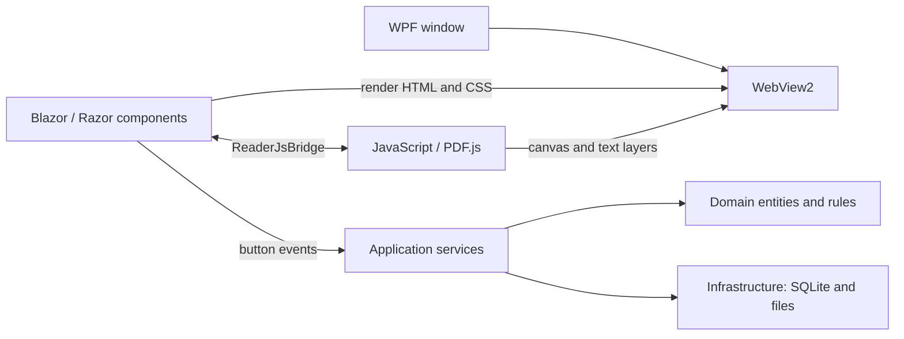

# How Folio fits together

Folio is a Windows application with a WPF shell and a Blazor interface. You can understand most of it using the C# you already know. The screens are Razor components and CSS; WPF creates the window and supplies Windows integration.

## 1. Startup

Start with [App.xaml.cs](../src/Folio.Desktop/App.xaml.cs). `OnStartup` is the WPF equivalent of a web application's entry point. It calls an async startup method and handles failures with a useful native message.

The dependency-injection registrations say which concrete class supplies each interface. For example, asking for `IFilePickerService` produces the Windows file-dialog implementation. Asking for `ILibraryService` produces the database-backed library service. Interfaces keep the UI from knowing how SQLite or Windows dialogs work.

Startup upgrades and checks SQLite **before** starting workers. It then opens `MainWindow`. That window contains a `BlazorWebView`, which renders `MainApp` into the `#app` element in `index.html`. `MainApp` displays `MainLayout`.

Exercise: place a breakpoint in `StartAsync`, then in the `MainWindow` constructor. Step through them and watch when the window becomes visible.

## 2. The library

`MainLayout` owns navigation, the open book, import progress, and appearance preferences. `LibraryView` owns the library's sort order and virtualized rows. Opening a card changes the layout's `_book` state; Blazor then displays a `ReaderView`. The library stays mounted behind it, preserving the browsing position.

`ILibraryService.QueryAsync` accepts the search, status, shelf, sort, and requested range. The implementation creates a fresh EF Core context, asks SQLite for that range, and returns untracked books. `Virtualize` requests only the rows needed near the viewport.

The context is a database session, not an application-wide singleton. Keeping a single context alive across timers and UI callbacks can produce concurrent-operation errors and stale data.

Exercise: put a breakpoint in `QueryAsync`, switch grid/list mode, and inspect `Start` and `Count`. Try a status filter and observe how the query changes.

## 3. Importing a PDF

The Add books button opens a native file picker through an interface. Each selected file is processed independently:

1. Compute SHA-256 to identify identical files.
2. Check whether that book already exists.
3. Copy it atomically into managed storage.
4. Extract metadata and render a cover.
5. Save the book and initial reading position to SQLite.

The original file stays intact. Each file gets an honest success, duplicate, or error result. Cancellation keeps books already imported. A failed metadata parse is reported rather than silently accepting a broken PDF as a one-page book.

Exercise: import the same fixture twice and inspect the two results. Confirm that SQLite contains one book with that hash.

## 4. Reading and JavaScript interop

Read [ReaderView.razor](../src/Folio.UI/Pages/ReaderView.razor) alongside [folio-reader.js](../src/Folio.UI/wwwroot/js/folio-reader.js).

Razor owns the toolbar, panels, dialogs, and reading state. JavaScript owns **only the dedicated PDF viewport**. This boundary matters: replacing HTML that Blazor owns can erase controls or leave its rendering state inconsistent.

`ReaderJsBridge` invokes JavaScript methods such as `goToPage`. JavaScript calls `[JSInvokable]` C# methods such as `OnPositionChanged` with typed JSON payloads. The PDF itself is loaded through the local `folio.books` virtual host, rather than passing the file across the interop bridge.

PDF.js draws the visible pages on canvases and adds an invisible text layer for selection. Distant canvases are recycled. PDF links use the viewport's coordinate transform; the installed PDF.js 6 API provides point conversion, so the code converts both corners of each link rectangle.

Exercise: break on `OnPositionChanged`, advance a page, and inspect the zero-based page index, offset, and zoom. A displayed page number is the stored index plus one.

## 5. Notes and bookmarks

Selecting text produces a page index and normalized rectangles. Coordinates between zero and one describe where the selection sits on the page, independently of pixel size. A highlight stores those rectangles and the selected text in SQLite. It does not edit the PDF.

When a page renders again, C# retrieves its annotations and JavaScript draws them over the canvas. Rotation transforms stored rectangles into the current view. Notes add your text to the same annotation record; Notebook provides links back to the source page.

Exercise: highlight a phrase, close the book, reopen it, then rotate the page. Compare the saved rectangle with the visible highlight.

## 6. Saving and recovery

Position events are throttled so continuous scrolling still reports movement. A two-second loop saves dirty reading state using a fresh service scope. Orderly window close performs a final database flush before stopping the host. Saving does not depend on the UI renderer surviving teardown.

An entity property describes the schema the code expects. A **migration** changes an existing database to that schema. The original missing-column bug occurred because the entity gained `CharacterOffset` while the startup migration did not create it. Tests using `EnsureCreated()` bypassed that history. The new compatibility tests start from the historical schema and exercise the real migration path.

Backups use SQLite's online snapshot API so committed WAL changes are included. Restore checks and upgrades a staged database first, excludes writers during replacement, keeps a rollback snapshot, and invalidates contexts that existed before the restore.

Exercise: run `StartupCompatibilityTests`, then `BackupSafetyTests`. Read the assertions as descriptions of behavior the application must preserve.

## Where to change things

| Change | Starting place |
|---|---|
| Navigation, search header, import UI | `MainLayout` |
| Book browsing and virtualized rows | `LibraryView`, `ILibraryService` |
| Colors, spacing, card styles | `Folio.UI/wwwroot/css/m3-tokens.css` |
| Reader toolbar and panels | `ReaderToolbar`, `ReaderSidebar`, `ReaderView` |
| PDF selection, rendering, and coordinates | `folio-reader.js`, `reader-geometry.mjs` |
| Business rules and stored entities | `Folio.Domain`, `Folio.Application` |
| SQL schema upgrades, storage, and backups | `Folio.Infrastructure` |
| Windows-specific behavior | `Folio.Desktop` |

The reader's JavaScript and CSS have one authoritative copy under `Folio.UI/wwwroot`. The desktop host consumes those static assets. The disconnected TypeScript scaffold and duplicated desktop asset tree were removed.
