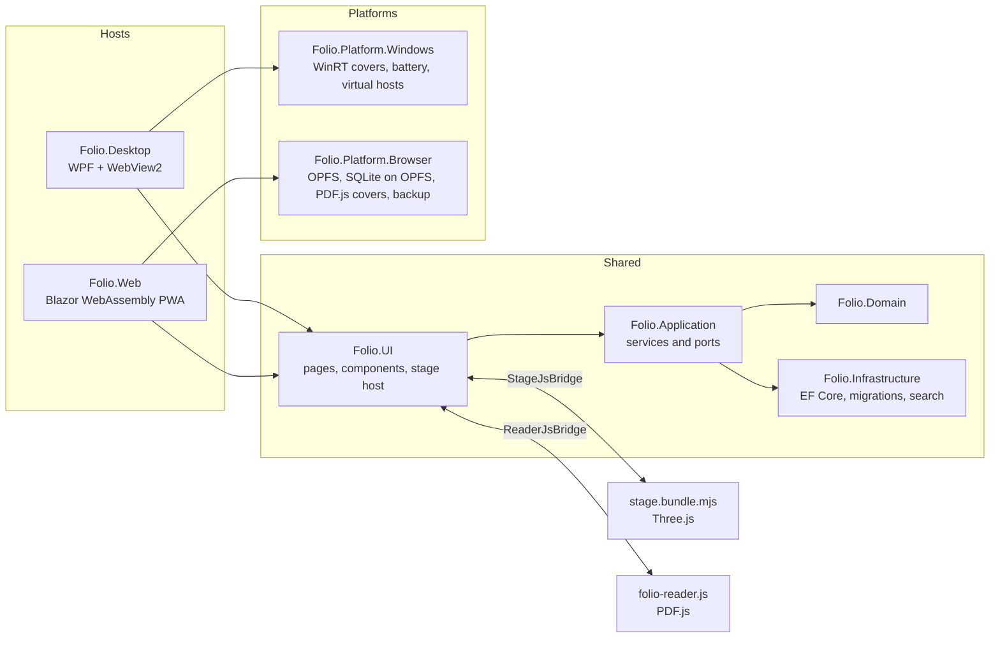

# How Folio fits together

Folio is one Blazor interface that ships to two hosts: a Windows app (WPF + WebView2) and a web app (Blazor WebAssembly,
installable, offline). The library is a calm 3D stage drawn with Three.js; reading is the 2D PDF.js reader. You can
understand most of it with the C# you already know: screens are Razor components and CSS, and each host only wires
platform services together.

The product spec for this design is [docs/folio-3d/SPEC.md](folio-3d/SPEC.md); decisions and deviations are in
[DECISIONS.md](folio-3d/DECISIONS.md) and progress in [PROGRESS.md](folio-3d/PROGRESS.md).

## 1. Startup and platforms

Shared code targets `net10.0` only. Each host registers one platform:

| Port | Windows | Browser |
|---|---|---|
| `IFileStore` | Folder under `%LocalAppData%\Folio` | In-memory working area mirrored to the Origin Private File System |
| `IDatabaseSetup` | SQLite file + `DatabaseMigrator` | SqliteWasmBlazor (SQLite on OPFS) + the same migrator |
| `IBookUrlResolver` | `https://folio.books/…`, `https://folio.covers/…` | Blob URLs read from OPFS |
| `IPdfRasterizer` | WinRT `Windows.Data.Pdf` | PDF.js, 512 px covers |
| `IPdfTextExtractor` | PdfPig | PDF.js text content (faster in WebAssembly) |
| `IBatteryMonitor` | Win32 power status | Battery Status API where available |
| `IPlatformCapabilities` | folder import, Locate PDF, command line | folder import, backup |

Desktop: [App.xaml.cs](../src/Folio.Desktop/App.xaml.cs) builds the host, runs `IDatabaseSetup` **before** starting
workers, and opens `MainWindow`, whose `BlazorWebView` renders [Routes](../src/Folio.UI/Routes.razor).
Web: [Program.cs](../src/Folio.Web/Program.cs) registers the browser platform; [App.razor](../src/Folio.Web/App.razor)
waits for the first render (SQLite starts its worker then), initialises storage, and renders the same `Routes`.

Exercise: put breakpoints in both hosts' start-up and compare which `IFileStore` each resolves.

## 2. Routes and the layout

Every view has an address, so Back/Forward, deep links and reload work: `/`, `/shelf/{id?}`, `/book/{id}`,
`/book/{id}/read?page=n`, `/search?q=`, `/trash`, `/settings`. Addresses are built by `FolioRoutes` and are relative to the
base href, which lets the web app live under a sub-path.

`MainLayout` owns the sidebar, header, import progress and the **persistent stage**. It stays mounted while you read
(hidden), so the stage survives route changes and can animate the book into the reader. `FolioNavigator` opens and
closes books and remembers where you came from.

## 3. The 3D stage

The stage is a pure view. Blazor owns state, data and navigation; the stage shows the scene it is told to and reports
intent (hover, activate, scroll, settled, handoff). Only state changes cross the bridge — the frame loop stays in JS.

- Sources: [src/Folio.UI/stage/](../src/Folio.UI/stage/), bundled by `npm run build:stage`: `index.js` (the `Stage`),
  `scenes.js` and `layout.js` (poses and row maths), `bookcase.js`, `pan.js`, `input.js`, `book-factory.js`,
  `hardcover.js`, `cover-composer.js`, `cover-design.js`, `book-look.js`, `reading.js`, `curl-page.js`, `page-textures.js`.
- .NET side: [StageHost.razor](../src/Folio.UI/Stage/StageHost.razor), [StageJsBridge.cs](../src/Folio.UI/Stage/StageJsBridge.cs),
  [StageState.cs](../src/Folio.UI/Stage/StageState.cs). Pages call `Stage.Show(scene, this)` and `Stage.Release(this)`.
- **One bookcase.** Every shelf is a plank row of one wooden case (`bookcase.js`: planks, uprights, back panel, brass
  labels; three shared wood maps from `scripts/gen-wood.mjs`). Only books near the camera have meshes, reused from a pool.
- **Shelf navigation.** `ShelfNavigator` (C#) is the single list of rows with a version, a current and a target row.
  `GestureGate` (JS) turns a wheel gesture into one step. The stage reports arrival; a stale row list asks .NET for the
  library again instead of guessing a row.
- **Books** are hardcovers (`hardcover.js`, one merged mesh) painted from the book's own title and author
  (`cover-composer.js`): four templates chosen by a hash of the id, cached as images so a restart does not repaint.
- **Motion.** Every moving value damps toward its target (`damp(value, target, λ, dt)`); frames are drawn only while
  something is still settling. A book is at rest, lifted (hover) or presented; the camera pans with `Pan` (momentum,
  rubber band). `window.__folioStage.stats` shows frames, draw calls and timings.
- Without WebGL2, on a software renderer, after two context losses, when persistently slow, or when you choose 2D in
  Settings, the library uses CSS 3D books (`CssBook.razor`, same generated covers). Every action works in both.

Accessibility: the canvas is `aria-hidden`. Each page renders a real HTML layer — the hero's copy and buttons, and on a
shelf a list with an Open button per book — and a polite live region announces scene changes.

Exercise: open the library with `?stageTest=1` (fixed clock, no idle motion), then watch
`window.__folioStage.stats.frames` stop increasing once nothing moves.

## 4. Reading in 3D

With Reading view set to 3D book, opening a book plays: forward → cover swings open → lay flat → riffle to your page →
settle (about 1.6 s; any key or click skips it). `reading.js` builds the open book (two page blocks whose thickness follows
your progress, a hinged front cover, two page planes and a pool of six leaves); `curl-page.js` rolls a leaf round a
cylinder in the vertex shader for a real curl. Page images come from the reader engine (`renderPageImage`), kept in an
8-page cache with the neighbouring spreads rendered ahead.

The reader engine stays in charge of everything you can touch. In its `spread` layout the stage tells it where the two
pages are (`folio-spread`, viewport pixels), and it fixes its page wrappers — text layer, links, highlights, bookmarks —
over them without drawing canvases. Selection, the quick bar, highlights, bookmarks and find work as in the flat reader.
Turning pages is the stage's job (← →, Page Up / Down, Home, End, `folio-turn`, `folio-goto`); the address
(`/book/{id}/read?page=n`) follows every turn. **Z** crossfades to the flat reader at the same page (Zoom); Esc returns to
the book, and Esc again closes it. Reduced motion opens and turns without the riffle and the curl.

Exercise: set a breakpoint in `Reading.update` and press → to watch `turnShape(u)` move the fold across the page.

## 5. Flat reading and JavaScript interop

With Reading view set to Flat pages (or when 3D is unavailable), a book opens the older way: the stage shows the cover swinging
open, the reader reports where it drew the current page, the stage aligns its page to that rectangle and a 120 ms crossfade
reveals the reader (`opening.js`); reduced motion uses a View Transition crossfade. The rest of this section is about that reader.

Read [ReaderView.razor](../src/Folio.UI/Pages/ReaderView.razor) alongside [folio-reader.js](../src/Folio.UI/wwwroot/js/folio-reader.js).
Razor owns the toolbar, panels and reading state; JavaScript owns **only the PDF viewport**. `ReaderJsBridge` calls
methods such as `goToPage`; JavaScript calls `[JSInvokable]` methods such as `OnPositionChanged` with typed payloads. The
PDF URL comes from `IBookUrlResolver` (virtual host on desktop, blob URL in the browser).

## 6. Highlights and bookmarks

Selecting text produces a page index and normalised rectangles (0–1 in page space). A highlight stores them and the
selected text in SQLite; it never edits the PDF. Double-click a highlight to remove it. Bookmarks are dog-ears or named
bookmarks. Marginalia, the Notebook, OCR and quote-with-citation were removed; their old data stays readable.

## 7. Saving, migrations and backup

A two-second loop saves dirty reading state in a fresh scope. Migrations in `DatabaseMigrator` are forward-only SQL steps
shared by both hosts. In the browser, Settings → Library backup exports one `.zip` (database, PDFs, covers) and restores
it into an empty profile; Folio asks for persistent storage and reminds you to back up.

## Where to change things

| Change | Starting place |
|---|---|
| Navigation, header, import UI, the persistent stage | `MainLayout`, `FolioNavigator`, `FolioRoutes` |
| Library pages (hero, shelves, 2D library), the book menu | `LibraryPage`, `LibraryView`, `LibraryHero`, `CssBook`, `BookMenu` |
| 3D scenes, bookcase, covers, motion, 3D reading | `src/Folio.UI/stage/*` then `npm run build:stage` |
| Colours, type, chrome | `m3-tokens.css` (tokens, fonts), `folio-library.css` (components) |
| Reader | `ReaderView`, `ReaderToolbar`, `folio-reader.js` |
| Storage and SQL schema | `Folio.Infrastructure` |
| Windows-only behaviour | `Folio.Platform.Windows`, `Folio.Desktop` |
| Browser-only behaviour | `Folio.Platform.Browser`, `Folio.Web` |
